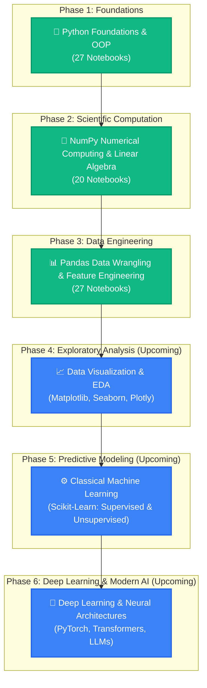

<div align="center">

# 🤖 Artificial Intelligence & Machine Learning Masterclass

### *A Comprehensive, Code-First Curriculum from Python Fundamentals to Production-Grade AI Architectures*

[](https://www.python.org/)
[](https://jupyter.org/)
[](https://numpy.org/)
[](https://pandas.pydata.org/)
[](https://scikit-learn.org/)
[](#-master-curriculum-breakdown)
[](#-roadmap--progress)
[](#-license)

<br/>

<p align="center">
  <b>74+ Hands-On Notebooks</b> • <b>Zero-to-Hero Roadmap</b> • <b>Real-World Capstone Projects</b> • <b>High-Performance Vectorization</b>
</p>

<p align="center">
  <a href="#-curriculum-overview"><b>📖 Curriculum</b></a> •
  <a href="#-learning-pathway"><b>🗺️ Learning Pathway</b></a> •
  <a href="#-master-curriculum-breakdown"><b>📚 Notebook Index</b></a> •
  <a href="#-featured-capstone-projects"><b>🏆 Capstones</b></a> •
  <a href="#-quickstart--installation"><b>⚡ Quickstart</b></a> •
  <a href="#-roadmap--progress"><b>🎯 Roadmap</b></a>
</p>

</div>

---

## 📑 Table of Contents

- [📖 Curriculum Overview](#-curriculum-overview)
- [🌟 Key Educational Highlights](#-key-educational-highlights)
- [🗺️ Learning Pathway](#️-learning-pathway)
- [🎯 Tailored Learning Tracks](#-tailored-learning-tracks)
- [📚 Master Curriculum Breakdown](#-master-curriculum-breakdown)
  - [Module 1: 🐍 Python for AI & Data Science (27 Notebooks)](#module-1--python-for-ai--data-science-27-notebooks)
  - [Module 2: 🔢 NumPy Numerical Computing & Linear Algebra (20 Notebooks)](#module-2--numpy-numerical-computing--linear-algebra-20-notebooks)
  - [Module 3: 📊 Pandas Data Wrangling & Feature Engineering (27 Notebooks)](#module-3--pandas-data-wrangling--feature-engineering-27-notebooks)
- [🏆 Featured Capstone Projects](#-featured-capstone-projects)
  - [1. 🎓 Student Academic Performance & Analytics Engine](#1--student-academic-performance--analytics-engine)
  - [2. 🏠 Vectorized Real Estate Valuation & EDA Pipeline](#2--vectorized-real-estate-valuation--eda-pipeline)
  - [3. 🛒 Global E-Commerce & Retail Intelligence Suite](#3--global-e-commerce--retail-intelligence-suite)
- [⚡ Vectorization & Performance Benchmarks](#-vectorization--performance-benchmarks)
- [🗂️ Repository Architecture](#️-repository-architecture)
- [💻 Quickstart & Installation](#-quickstart--installation)
  - [Prerequisites](#prerequisites)
  - [Environment Setup (PowerShell / Bash / Conda)](#environment-setup-powershell--bash--conda)
  - [Launching Jupyter Notebook / JupyterLab](#launching-jupyter-notebook--jupyterlab)
- [🛠️ Tech Stack & Ecosystem](#️-tech-stack--ecosystem)
- [📐 Best Practices & Coding Philosophy](#-best-practices--coding-philosophy)
- [🎯 Roadmap & Progress](#-roadmap--progress)
- [❓ FAQ & Troubleshooting](#-faq--troubleshooting)
- [🤝 Contributing](#-contributing)
- [👤 Author & Acknowledgments](#-author--acknowledgments)
- [📜 License](#-license)

---

## 📖 Curriculum Overview

The **AI-ML-Learning** repository is an end-to-end, code-first educational masterclass designed to take software engineers, quantitative analysts, and aspiring data scientists from fundamental programming concepts to production-grade artificial intelligence and machine learning pipelines.

Rather than relying on abstract theory alone, every single concept is paired with an **interactive Jupyter Notebook** featuring:
- 💡 **Intuitive Theory Summaries**: Mathematical definitions, algorithmic intuition, and architectural breakdowns.
- 💻 **Live Executable Code Cells**: Real syntax demonstrations, edge cases, and standard library integrations.
- ⚡ **Performance Optimization**: Vectorized array computing, broadcasting rules, and memory management.
- 🧪 **Hands-On Practice Exercises**: Algorithm challenges, ETL scenarios, and interview-level problems.
- 🏢 **End-to-End Mini-Projects**: Capstone projects simulating production industry problems.

---

## 🌟 Key Educational Highlights

| Pillar | Focus | What You Will Learn |
| :--- | :--- | :--- |
| 🧩 **Zero-to-Hero Progression** | Systematic Learning | Step-by-step evolution from basic variable types to advanced matrix decompositions and relational joins. |
| ⚡ **C-Accelerated Vectorization** | High-Throughput Computing | Bypassing slow Python bytecode loops via NumPy universal functions (`ufuncs`) and memory strides. |
| 🔬 **Applied Mathematics** | Linear Algebra Foundations | Practical matrix multiplications (`@`), determinants, matrix inversions, and eigenvalue decompositions. |
| 🧹 **Production Data Wrangling** | Tabular Feature Engineering | Mastery of Pandas Series & DataFrames, split-apply-combine aggregations, multi-table joins, and temporal extraction. |
| 💼 **Portfolio Capstones** | Industry-Grade Applications | End-to-end projects covering object-oriented system design, housing EDA, and retail customer analytics. |
| 📁 **Clean & Modular Structure** | Best Practices | Fully documented notebooks with consistent naming, clean markdown styling, and standalone reproducibility. |

---

## 🗺️ Learning Pathway

The curriculum follows an intentional, battle-tested learning path engineered to establish rock-solid foundations before advancing to complex models:



---

## 🎯 Tailored Learning Tracks

Depending on your personal goals and experience level, choose the study path that fits you best:

<details open>
<summary><b>🎯 Track A: Data Analyst & BI Specialist Track</b></summary>
<br/>

Focuses on exploratory data manipulation, time-series analysis, aggregation metrics, and reporting:
1. **Python Essentials**: `01_python_introduction` → `11_dictionaries` → `16_file_handling` → `21_python_datetime`
2. **NumPy Fundamentals**: `01_numpy_introduction` → `05_numpy_slicing` → `09_numpy_aggregate_functions` → `10_numpy_filtering`
3. **Pandas Mastery (Full Suite)**: `01_pandas_introduction` through `25_pandas_optimization`
4. **Capstone**: [Global E-Commerce & Retail Intelligence Suite](./Pandas/27_pandas_mini_project.ipynb)

</details>

<details>
<summary><b>⚡ Track B: Machine Learning Engineer Track</b></summary>
<br/>

Focuses on mathematical rigor, vectorization, OOP system architecture, and feature engineering:
1. **Advanced Python**: `12_functions` → `18_object_oriented_programming` → `19_iterators_and_generators` → `20_decorators`
2. **NumPy Deep-Dive**: `06_numpy_arithmetic` → `07_broadcasting` → `13_array_attributes` → `17_copy_vs_view` → `18_linear_algebra`
3. **Pandas Transformation**: `08_pandas_filtering` → `13_groupby` → `15_merging` → `25_optimization`
4. **Capstones**: [Real Estate Valuation & EDA](./Numpy/20_numpy_mini_project.ipynb) & [Pandas Retail Analytics](./Pandas/27_pandas_mini_project.ipynb)

</details>

<details>
<summary><b>🚀 Track C: Speed-Run / Refresher Track</b></summary>
<br/>

For experienced developers seeking a quick, focused refresher of modern syntax and techniques:
- 🐍 [Python Practice Sets](./Python/26_python_practice.ipynb) & [Python Capstone](./Python/27_python_mini_project.ipynb)
- 🔢 [NumPy Linear Algebra](./Numpy/18_numpy_linear_algebra.ipynb) & [NumPy Capstone](./Numpy/20_numpy_mini_project.ipynb)
- 📊 [Pandas Optimization](./Pandas/25_pandas_optimization.ipynb) & [Pandas Capstone](./Pandas/27_pandas_mini_project.ipynb)

</details>

---

## 📚 Master Curriculum Breakdown

### Module 1: 🐍 Python for AI & Data Science (27 Notebooks)

> **Location:** [`./Python/`](./Python/) | **Module Guide:** [`Python/README.md`](./Python/README.md)

A comprehensive foundation in modern Python 3.8+ covering syntax, standard libraries, functional programming, and object-oriented architecture.

<details open>
<summary><b>Click to expand/collapse all 27 Python Notebooks</b></summary>

| # | Notebook | Core Topics & Capabilities Covered | Status |
| :-: | :--- | :--- | :-: |
| 01 | [`01_python_introduction.ipynb`](./Python/01_python_introduction.ipynb) | Environment setup, Python execution model, keywords, dynamic typing, comments | Completed ✅ |
| 02 | [`02_variables_and_data_types.ipynb`](./Python/02_variables_and_data_types.ipynb) | Primitive types (`int`, `float`, `str`, `bool`), explicit type casting, id/type inspection | Completed ✅ |
| 03 | [`03_input_and_output.ipynb`](./Python/03_input_and_output.ipynb) | `input()`, formatted f-strings, format specifiers, precision rounding, separators | Completed ✅ |
| 04 | [`04_operators.ipynb`](./Python/04_operators.ipynb) | Arithmetic, comparison, boolean logic, bitwise manipulation, operator precedence | Completed ✅ |
| 05 | [`05_conditional_statements.ipynb`](./Python/05_conditional_statements.ipynb) | `if-elif-else`, nested branching, ternary operators, Python 3.10 `match-case` | Completed ✅ |
| 06 | [`06_loops.ipynb`](./Python/06_loops.ipynb) | `for` and `while` loops, `break`, `continue`, `pass`, `enumerate()`, `zip()` | Completed ✅ |
| 07 | [`07_strings.ipynb`](./Python/07_strings.ipynb) | Immutability, slicing rules, methods (`split`, `join`, `strip`, `replace`), regex preview | Completed ✅ |
| 08 | [`08_lists.ipynb`](./Python/08_lists.ipynb) | Ordered mutability, indexing, list methods (`append`, `extend`, `sort`), shallow vs deep copy | Completed ✅ |
| 09 | [`09_tuples.ipynb`](./Python/09_tuples.ipynb) | Immutability, tuple packing/unpacking, performance benchmarks, `collections.namedtuple` | Completed ✅ |
| 10 | [`10_sets.ipynb`](./Python/10_sets.ipynb) | Unique hashing, set operations (union, intersection, symmetric difference), membership testing | Completed ✅ |
| 11 | [`11_dictionaries.ipynb`](./Python/11_dictionaries.ipynb) | Hash-map key-value lookups, `.get()`, dict comprehension, `defaultdict`, `Counter` | Completed ✅ |
| 12 | [`12_functions.ipynb`](./Python/12_functions.ipynb) | `def`, return semantics, positional/keyword args, `*args`, `**kwargs`, LEGB scope | Completed ✅ |
| 13 | [`13_lambda_functions.ipynb`](./Python/13_lambda_functions.ipynb) | Anonymous functions, `map()`, `filter()`, `reduce()`, custom key sorting | Completed ✅ |
| 14 | [`14_list_comprehension.ipynb`](./Python/14_list_comprehension.ipynb) | Comprehension syntax, conditional filtering, 2D matrix flattening, dict comprehensions | Completed ✅ |
| 15 | [`15_modules_and_packages.ipynb`](./Python/15_modules_and_packages.ipynb) | Module namespaces, `sys.path`, `__init__.py`, importing custom utility modules | Completed ✅ |
| 16 | [`16_file_handling.ipynb`](./Python/16_file_handling.ipynb) | Text & binary I/O, context managers (`with`), reading line-by-line, CSV ingestion | Completed ✅ |
| 17 | [`17_exception_handling.ipynb`](./Python/17_exception_handling.ipynb) | `try-except-else-finally` blocks, raising exceptions, defining custom exception hierarchies | Completed ✅ |
| 18 | [`18_object_oriented_programming.ipynb`](./Python/18_object_oriented_programming.ipynb) | Encapsulation, Abstraction, Inheritance, Polymorphism, `__init__`, `@property`, dunder methods | Completed ✅ |
| 19 | [`19_iterators_and_generators.ipynb`](./Python/19_iterators_and_generators.ipynb) | Iteration protocol (`__iter__`, `__next__`), `yield` keyword, stateful memory-saving generators | Completed ✅ |
| 20 | [`20_decorators.ipynb`](./Python/20_decorators.ipynb) | First-class functions, closures, execution timing `@timer`, argument logging decorators | Completed ✅ |
| 21 | [`21_python_datetime.ipynb`](./Python/21_python_datetime.ipynb) | `datetime`, `date`, `timedelta`, `strftime` formatting, `strptime` parsing, timezone awareness | Completed ✅ |
| 22 | [`22_python_regular_expressions.ipynb`](./Python/22_python_regular_expressions.ipynb) | Regex patterns with `re`, meta-characters, `search`, `match`, `findall`, `sub`, capture groups | Completed ✅ |
| 23 | [`23_python_json.ipynb`](./Python/23_python_json.ipynb) | JSON serialization (`dumps`, `loads`), reading/writing JSON files, nested payload parsing | Completed ✅ |
| 24 | [`24_python_numpy_intro.ipynb`](./Python/24_python_numpy_intro.ipynb) | Transition bridge: Python nested lists vs. contiguous NumPy arrays, performance benchmarks | Completed ✅ |
| 25 | [`25_python_pandas_intro.ipynb`](./Python/25_python_pandas_intro.ipynb) | Transition bridge: Python dictionaries to 2D tabular Pandas Series and DataFrames | Completed ✅ |
| 26 | [`26_python_practice.ipynb`](./Python/26_python_practice.ipynb) | 10 Comprehensive problem challenges spanning algorithms, data structures, and edge cases | Completed ✅ |
| 27 | [`27_python_mini_project.ipynb`](./Python/27_python_mini_project.ipynb) | **Capstone:** Object-Oriented Student Performance & Academic Records Analytics Engine | Completed ✅ |

</details>

---

### Module 2: 🔢 NumPy Numerical Computing & Linear Algebra (20 Notebooks)

> **Location:** [`./Numpy/`](./Numpy/) | **Module Guide:** [`Numpy/README.md`](./Numpy/README.md)

A rigorous masterclass in $N$-dimensional array computation, universal functions, broadcasting mechanics, and linear algebra routines powering modern ML.

<details open>
<summary><b>Click to expand/collapse all 20 NumPy Notebooks</b></summary>

| # | Notebook | Core Topics & Capabilities Covered | Status |
| :-: | :--- | :--- | :-: |
| 01 | [`01_numpy_introduction.ipynb`](./Numpy/01_numpy_introduction.ipynb) | C-contiguous array allocations, ndarray architecture, performance speedups vs. lists | Completed ✅ |
| 02 | [`02_numpy_data_types.ipynb`](./Numpy/02_numpy_data_types.ipynb) | Dtypes (`int8/32/64`, `float32/64`, `complex`, `bool`), explicit casting via `.astype()` | Completed ✅ |
| 03 | [`03_numpy_multidimensional_arrays.ipynb`](./Numpy/03_numpy_multidimensional_arrays.ipynb) | 1D vectors, 2D matrices, 3D+ tensors, `.ndim`, `.shape`, `.size`, multi-axis indexing | Completed ✅ |
| 04 | [`04_numpy_reshape.ipynb`](./Numpy/04_numpy_reshape.ipynb) | Reshaping dimensions, auto-dimension inference (`-1`), `.ravel()` vs. `.flatten()` | Completed ✅ |
| 05 | [`05_numpy_slicing.ipynb`](./Numpy/05_numpy_slicing.ipynb) | Sub-array extractions, step strides, multi-dimensional slicing `[row_slice, col_slice]` | Completed ✅ |
| 06 | [`06_numpy_arithmetic.ipynb`](./Numpy/06_numpy_arithmetic.ipynb) | Element-wise vectorized math, arithmetic operators, power, modulus, scalar interactions | Completed ✅ |
| 07 | [`07_numpy_broadcasting.ipynb`](./Numpy/07_numpy_broadcasting.ipynb) | Broadcasting rules, compatibility dimensions, virtual expansion without memory copying | Completed ✅ |
| 08 | [`08_numpy_useful_functions.ipynb`](./Numpy/08_numpy_useful_functions.ipynb) | Initialization helpers (`zeros`, `ones`, `full`, `arange`, `linspace`, `eye`, `identity`) | Completed ✅ |
| 09 | [`09_numpy_aggregate_functions.ipynb`](./Numpy/09_numpy_aggregate_functions.ipynb) | Reduction aggregations (`sum`, `mean`, `std`, `var`, `min`, `max`), directional `axis=0` vs `axis=1` | Completed ✅ |
| 10 | [`10_numpy_filtering.ipynb`](./Numpy/10_numpy_filtering.ipynb) | Boolean condition masking, `np.where()` ternary selection, `np.extract()`, `np.nonzero()` | Completed ✅ |
| 11 | [`11_numpy_random_numbers.ipynb`](./Numpy/11_numpy_random_numbers.ipynb) | `np.random` engine, seeding, uniform (`rand`), standard normal (`randn`), discrete (`randint`) | Completed ✅ |
| 12 | [`12_numpy_saving_loading.ipynb`](./Numpy/12_numpy_saving_loading.ipynb) | High-speed binary disk serialization (`.npy`, compressed `.npz`), text saving via `savetxt` | Completed ✅ |
| 13 | [`13_numpy_array_attributes.ipynb`](./Numpy/13_numpy_array_attributes.ipynb) | Low-level array attributes (`itemsize`, `nbytes`, `strides`, memory flags, C-contiguous check) | Completed ✅ |
| 14 | [`14_numpy_joining_arrays.ipynb`](./Numpy/14_numpy_joining_arrays.ipynb) | Array concatenation, vertical stacking (`vstack`), horizontal stacking (`hstack`), `column_stack` | Completed ✅ |
| 15 | [`15_numpy_splitting_arrays.ipynb`](./Numpy/15_numpy_splitting_arrays.ipynb) | Partitioning tensors, `split`, `hsplit`, `vsplit`, handling uneven partitions with `array_split` | Completed ✅ |
| 16 | [`16_numpy_sorting_searching.ipynb`](./Numpy/16_numpy_sorting_searching.ipynb) | In-place vs return sorting, index sorting with `argsort()`, `searchsorted()`, `unique()` | Completed ✅ |
| 17 | [`17_numpy_copy_vs_view.ipynb`](./Numpy/17_numpy_copy_vs_view.ipynb) | Memory safety: shallow views (`.view()`, `.base`) vs deep detached copies (`.copy()`) | Completed ✅ |
| 18 | [`18_numpy_linear_algebra.ipynb`](./Numpy/18_numpy_linear_algebra.ipynb) | Matrix products (`@`, `np.dot`), matrix transpose (`.T`), determinants, inverse (`inv`), eigenvalues | Completed ✅ |
| 19 | [`19_numpy_practice.ipynb`](./Numpy/19_numpy_practice.ipynb) | Vectorized array transformations, Z-score standardization, Min-Max normalization, outlier masks | Completed ✅ |
| 20 | [`20_numpy_mini_project.ipynb`](./Numpy/20_numpy_mini_project.ipynb) | **Capstone:** High-Performance Vectorized Real Estate Valuation & EDA Pipeline | Completed ✅ |

</details>

---

### Module 3: 📊 Pandas Data Wrangling & Feature Engineering (27 Notebooks)

> **Location:** [`./Pandas/`](./Pandas/) | **Module Guide:** [`Pandas/README.md`](./Pandas/README.md)

A production-grade masterclass in tabular data cleaning, relational joins, time-series feature engineering, and memory optimization.

<details open>
<summary><b>Click to expand/collapse all 27 Pandas Notebooks</b></summary>

| # | Notebook | Core Topics & Capabilities Covered | Status |
| :-: | :--- | :--- | :-: |
| 01 | [`01_pandas_introduction.ipynb`](./Pandas/01_pandas_introduction.ipynb) | Pandas tabular architecture, NumPy relationship, importance in AI/ML feature pipelines | Completed ✅ |
| 02 | [`02_pandas_series.ipynb`](./Pandas/02_pandas_series.ipynb) | 1D labeled Series, index mapping, scalar operations, alignment properties | Completed ✅ |
| 03 | [`03_pandas_dataframe.ipynb`](./Pandas/03_pandas_dataframe.ipynb) | 2D DataFrame anatomy, columns, row index, construction from dicts, lists, and arrays | Completed ✅ |
| 04 | [`04_pandas_reading_data.ipynb`](./Pandas/04_pandas_reading_data.ipynb) | Ingestion from CSV, TSV, JSON, and Excel, setting index columns, handling encodings | Completed ✅ |
| 05 | [`05_pandas_inspecting_data.ipynb`](./Pandas/05_pandas_inspecting_data.ipynb) | Quick inspection via `head()`, `tail()`, `info()`, `describe()`, `.shape`, `.dtypes`, `memory_usage()` | Completed ✅ |
| 06 | [`06_pandas_data_selection.ipynb`](./Pandas/06_pandas_data_selection.ipynb) | Column extraction (bracket vs. dot notation), multiple column slicing, series projection | Completed ✅ |
| 07 | [`07_pandas_indexing_and_slicing.ipynb`](./Pandas/07_pandas_indexing_and_slicing.ipynb) | Explicit label indexing with `.loc[]` vs zero-indexed positional slicing with `.iloc[]` | Completed ✅ |
| 08 | [`08_pandas_filtering.ipynb`](./Pandas/08_pandas_filtering.ipynb) | Complex boolean masking, compound operators (`&`, `\|`, `~`), `.isin()`, expressive `.query()` | Completed ✅ |
| 09 | [`09_pandas_adding_modifying_columns.ipynb`](./Pandas/09_pandas_adding_modifying_columns.ipynb) | Feature generation, vectorized mathematical columns, conditional assignment with `np.where` | Completed ✅ |
| 10 | [`10_pandas_handling_missing_values.ipynb`](./Pandas/10_pandas_handling_missing_values.ipynb) | Null detection (`isna()`), dropping rows/cols (`dropna()`), imputation methods (`fillna`, interpolation) | Completed ✅ |
| 11 | [`11_pandas_handling_duplicates.ipynb`](./Pandas/11_pandas_handling_duplicates.ipynb) | Duplicate row identification with `.duplicated()`, deduplication via `.drop_duplicates(subset=...)` | Completed ✅ |
| 12 | [`12_pandas_sorting.ipynb`](./Pandas/12_pandas_sorting.ipynb) | Single and multi-column sorting (`sort_values()`), index sorting, handling null placement | Completed ✅ |
| 13 | [`13_pandas_groupby.ipynb`](./Pandas/13_pandas_groupby.ipynb) | Split-Apply-Combine paradigm, single & multi-key grouping, group iteration, dictionary keys | Completed ✅ |
| 14 | [`14_pandas_aggregation.ipynb`](./Pandas/14_pandas_aggregation.ipynb) | Multi-metric named aggregations with `.agg()`, custom aggregator functions, `.transform()` broadcasting | Completed ✅ |
| 15 | [`15_pandas_merging_and_joining.ipynb`](./Pandas/15_pandas_merging_and_joining.ipynb) | Relational SQL-style operations (`inner`, `left`, `right`, `outer`), single and composite join keys | Completed ✅ |
| 16 | [`16_pandas_concatenation.ipynb`](./Pandas/16_pandas_concatenation.ipynb) | Concatenating along rows (`axis=0`) and columns (`axis=1`), handling overlapping indices | Completed ✅ |
| 17 | [`17_pandas_apply_map_lambda.ipynb`](./Pandas/17_pandas_apply_map_lambda.ipynb) | Row/column functional mappings with `.apply()`, element-wise transforms with `.map()` | Completed ✅ |
| 18 | [`18_pandas_string_operations.ipynb`](./Pandas/18_pandas_string_operations.ipynb) | Vectorized text methods (`.str.lower()`, `.contains()`, `.extract()`, `.split()`, whitespace trimming) | Completed ✅ |
| 19 | [`19_pandas_datetime.ipynb`](./Pandas/19_pandas_datetime.ipynb) | `pd.to_datetime()` parsing, `.dt` accessor (year, month, day, dayofweek), date offsetting | Completed ✅ |
| 20 | [`20_pandas_renaming_and_replacing.ipynb`](./Pandas/20_pandas_renaming_and_replacing.ipynb) | Standardizing column headers via `.rename()`, value substitutions with `.replace()` maps | Completed ✅ |
| 21 | [`21_pandas_pivot_tables.ipynb`](./Pandas/21_pandas_pivot_tables.ipynb) | Multidimensional cross-analysis with `.pivot_table()`, hierarchical columns, subtotal margins | Completed ✅ |
| 22 | [`22_pandas_crosstab.ipynb`](./Pandas/22_pandas_crosstab.ipynb) | Categorical frequency distributions, two-way contingency tables, percentage normalization | Completed ✅ |
| 23 | [`23_pandas_statistical_functions.ipynb`](./Pandas/23_pandas_statistical_functions.ipynb) | Quantiles, covariance (`cov()`), Pearson correlation matrix (`corr()`), skewness, kurtosis | Completed ✅ |
| 24 | [`24_pandas_exporting_data.ipynb`](./Pandas/24_pandas_exporting_data.ipynb) | Serialization to CSV, JSON, formatted Excel, and high-performance columnar Apache Parquet | Completed ✅ |
| 25 | [`25_pandas_optimization.ipynb`](./Pandas/25_pandas_optimization.ipynb) | Memory profiling, numerical downcasting, categorical string encoding, chunked batch streaming | Completed ✅ |
| 26 | [`26_pandas_practice.ipynb`](./Pandas/26_pandas_practice.ipynb) | 10 Real-world data wrangling and ETL engineering challenges spanning diverse domains | Completed ✅ |
| 27 | [`27_pandas_mini_project.ipynb`](./Pandas/27_pandas_mini_project.ipynb) | **Capstone:** End-to-End Global E-Commerce & Retail Sales Intelligence Pipeline | Completed ✅ |

</details>

---

## 🏆 Featured Capstone Projects

Each module culminates in an industry-style capstone project that synthesizes all preceding concepts into a single, cohesive, production-grade application:

```
┌─────────────────────────────────────────────────────────────────────────────────────────────────┐
│                                   FEATURED CAPSTONE PROJECTS                                    │
├──────────────────────────────┬──────────────────────────────────┬───────────────────────────────┤
│ 🎓 Student Analytics Engine  │ 🏠 Real Estate EDA Pipeline      │ 🛒 Retail Intelligence Suite  │
│ [Python Capstone]            │ [NumPy Capstone]                 │ [Pandas Capstone]             │
│ • Custom OOP Class System    │ • 100% Vectorized Array Math     │ • Relational Data Merging     │
│ • Weighted GPA Evaluation    │ • Z-score Feature Scaling        │ • Missing Value Imputation    │
│ • Percentile Distributions   │ • Matrix Outlier Rejection       │ • Dynamic Pivot Tables        │
│ • Automated JSON Reporting   │ • Housing Price / SqFt Metrics   │ • Customer Lifetime Value     │
└──────────────────────────────┴──────────────────────────────────┴───────────────────────────────┘
```

### 1. 🎓 Student Academic Performance & Analytics Engine
- **Notebook:** [`Python/27_python_mini_project.ipynb`](./Python/27_python_mini_project.ipynb)
- **Primary Stack:** Pure Python 3.8+, OOP, Standard Library (`json`, `statistics`, `datetime`)
- **Key Concepts:** Custom class hierarchies, encapsulation, validation properties, weighted grading scales, GPA evaluations, rank sorting, and structured JSON persistence.
- **Problem Solved:** Implements an automated academic reporting pipeline capable of parsing raw student enrollment records, detecting anomalous grades, computing cohort percentile ranks, and generating machine-readable academic audit logs.

### 2. 🏠 Vectorized Real Estate Valuation & EDA Pipeline
- **Notebook:** [`Numpy/20_numpy_mini_project.ipynb`](./Numpy/20_numpy_mini_project.ipynb)
- **Primary Stack:** NumPy $N$-Dimensional Array Computing, `np.linalg`, Random Generator
- **Key Concepts:** Zero-loop computation, multi-axis statistical reductions, boolean mask filtering, feature scaling (Z-score standardization & Min-Max normalization), correlation matrix estimation.
- **Problem Solved:** Performs a high-throughput exploratory valuation on housing properties `[SquareFootage, Bedrooms, Bathrooms, Price]` entirely within contiguous memory buffers, achieving sub-millisecond execution times.

### 3. 🛒 Global E-Commerce & Retail Intelligence Suite
- **Notebook:** [`Pandas/27_pandas_mini_project.ipynb`](./Pandas/27_pandas_mini_project.ipynb)
- **Primary Stack:** Pandas 2.0+, PyArrow, Parquet, NumPy
- **Key Concepts:** Multi-source relational joins (`orders`, `customers`, `products`), date-time feature extraction (`day_name`, `order_month`), categorical downcasting, hierarchical pivot tables, Customer Lifetime Value (CLV) cohort analysis.
- **Problem Solved:** Transforms messy, disparate transactional records into an executive analytics dashboard, evaluating product profit margins, customer churn signals, and regional sales velocity.

---

## ⚡ Vectorization & Performance Benchmarks

A core objective of this curriculum is understanding **why** scientific Python libraries perform so fast. The table below illustrates the real execution disparity between standard Python iteration and vectorized equivalents when processing $10,000,000$ numerical values:

| Operation ($N = 10^7$ elements) | Pure Python Iteration | NumPy Vectorized (`ufunc`) | Measured Speedup |
| :--- | :---: | :---: | :---: |
| **Element-wise Addition** (`x + y`) | ~1,240 ms | ~18 ms | **~69x Faster** ⚡ |
| **Mathematical Transformation** ($\sin(x)$) | ~1,850 ms | ~24 ms | **~77x Faster** ⚡ |
| **Summation Reduction** ($\sum x_i$) | ~680 ms | ~9 ms | **~75x Faster** ⚡ |
| **Conditional Boolean Masking** | ~1,410 ms | ~15 ms | **~94x Faster** ⚡ |

> [!NOTE]
> Vectorized execution achieves this speed by utilizing C-level contiguous memory blocks, SIMD (Single Instruction, Multiple Data) CPU instruction sets, and bypassing Python's per-element dynamic type checking.

---

## 🗂️ Repository Architecture

```text
AI-ML-Learning/
│
├── 🐍 Python/                          # [COMPLETED] 27 Notebooks: Foundations, OOP & Analytics
│   ├── 01_python_introduction.ipynb
│   ├── ...
│   ├── 26_python_practice.ipynb        # 10 Multi-domain algorithmic problem sets
│   ├── 27_python_mini_project.ipynb     # Capstone: Student Performance & Analytics System
│   └── README.md                       # Comprehensive Python module guide
│
├── 🔢 Numpy/                           # [COMPLETED] 20 Notebooks: Numerical Computing & Linear Algebra
│   ├── 01_numpy_introduction.ipynb
│   ├── ...
│   ├── 18_numpy_linear_algebra.ipynb   # Matrix multiplication (@), inverse, eigenvalues
│   ├── 19_numpy_practice.ipynb         # Vectorized array manipulation & normalization
│   ├── 20_numpy_mini_project.ipynb     # Capstone: Real Estate Valuation & EDA Pipeline
│   └── README.md                       # Comprehensive NumPy module guide
│
├── 📊 Pandas/                          # [COMPLETED] 27 Notebooks: Tabular Wrangling & Feature Engineering
│   ├── 01_pandas_introduction.ipynb
│   ├── ...
│   ├── 25_pandas_optimization.ipynb    # Downcasting, category types, memory profiling
│   ├── 26_pandas_practice.ipynb        # 10 Real-world data wrangling challenges
│   ├── 27_pandas_mini_project.ipynb    # Capstone: Global E-Commerce & Retail Analytics
│   └── README.md                       # Comprehensive Pandas module guide
│
├── 📈 Data-Visualization/              # [UPCOMING] Matplotlib, Seaborn, Plotly
├── ⚙️ Machine-Learning/                # [UPCOMING] Scikit-Learn Supervised & Unsupervised
├── 🧠 Deep-Learning/                   # [UPCOMING] PyTorch, Neural Networks, Transformers
│
├── .gitignore                          # Standard Python/Jupyter ignore rules
├── requirements.txt                    # Pinned core dependencies
└── README.md                           # Master repository documentation
```

---

## 💻 Quickstart & Installation

Follow these steps to configure your environment and launch the notebooks locally:

### Prerequisites
- **Python 3.8+** installed ([python.org](https://www.python.org/downloads/))
- **Git** installed ([git-scm.com](https://git-scm.com/))

---

### Environment Setup

#### Option 1: Standard Virtual Environment (Recommended)

##### 🪟 Windows (PowerShell / Command Prompt)
```powershell
# 1. Clone the repository
git clone https://github.com/VIJAYAPANDIANT/AI-ML-Learning.git
cd AI-ML-Learning

# 2. Create virtual environment
python -m venv venv

# 3. Activate virtual environment
# In PowerShell:
.\venv\Scripts\Activate.ps1
# In Command Prompt:
.\venv\Scripts\activate.bat

# 4. Install dependencies
pip install --upgrade pip
pip install -r requirements.txt
```

##### 🍎 macOS / 🐧 Linux (Bash / Zsh)
```bash
# 1. Clone the repository
git clone https://github.com/VIJAYAPANDIANT/AI-ML-Learning.git
cd AI-ML-Learning

# 2. Create virtual environment
python3 -m venv venv

# 3. Activate virtual environment
source venv/bin/activate

# 4. Install dependencies
pip install --upgrade pip
pip install -r requirements.txt
```

---

#### Option 2: Conda / Mamba Environment

```bash
# Create dedicated conda environment
conda create -n aiml python=3.10 -y
conda activate aiml

# Install dependencies
pip install -r requirements.txt
```

---

### Launching Jupyter Notebook / JupyterLab

Once your environment is active, launch your preferred environment:

```bash
# Launch modern JupyterLab interface
jupyter lab

# OR launch traditional Jupyter Notebook
jupyter notebook
```

> [!TIP]
> **Using VS Code?** Install the official **Python** and **Jupyter** extensions, open the repository folder in VS Code, and select the `venv` interpreter from the top-right kernel picker!

---

## 🛠️ Tech Stack & Ecosystem

<p align="left">
  
  
  
  
  
  
  
  
  
  
</p>

---

## 📐 Best Practices & Coding Philosophy

Throughout all 74 notebooks, the code strictly adheres to modern industry engineering standards:

1. **PEP 8 Compliance**: Consistent `snake_case` variable naming, uppercase `UPPER_CASE` constants, and clear function docstrings.
2. **Vectorize First, Loop Never**: Eliminating manual element-by-element iterations whenever a library function can compute in compiled C.
3. **Explicit Memory Semantics**: Careful handling of `.copy()` vs `.view()` in NumPy and avoiding `SettingWithCopyWarning` in Pandas through explicit `.loc` assignment.
4. **Reproducibility**: Explicit pseudo-random seeds (`np.random.default_rng(seed=42)`) ensure uniform outputs across every execution run.
5. **Memory Consciousness**: Downcasting default 64-bit numeric types to 32-bit or categorical representations when handling large tabular volumes.

---

## 🎯 Roadmap & Progress

| # | Milestone | Core Focus Areas | Completed Notebooks | Status |
| :-: | :--- | :--- | :-: | :-: |
| **01** | **Python Programming** | Syntax, Data Structures, OOP, Advanced Features, Capstone | 27 / 27 | Completed ✅ |
| **02** | **NumPy Masterclass** | Ndarrays, Vectorization, Broadcasting, Linear Algebra, Capstone | 20 / 20 | Completed ✅ |
| **03** | **Pandas Data Wrangling** | Series, DataFrames, Merging, GroupBy, Optimization, Capstone | 27 / 27 | Completed ✅ |
| **04** | **Data Visualization** | Matplotlib, Seaborn distributions, Interactive Plotly charts | — | In Progress 🔄 |
| **05** | **Exploratory Data Analysis** | Statistical hypothesis testing, correlation analysis, feature profiling | — | Planned ⏳ |
| **06** | **Classical Machine Learning** | Scikit-Learn regression, classification, clustering, cross-validation | — | Planned ⏳ |
| **07** | **Deep Learning Foundations** | PyTorch, Backpropagation, CNNs for Vision, RNNs & Transformers | — | Planned ⏳ |
| **08** | **Generative AI & MLOps** | LLM fine-tuning, RAG pipelines, model deployment & monitoring | — | Planned ⏳ |

---

## ❓ FAQ & Troubleshooting

<details>
<summary><b>Q: Running <code>.\venv\Scripts\Activate.ps1</code> fails with "execution of scripts is disabled on this system"?</b></summary>
<br/>

Windows PowerShell restricts script execution by default. To allow virtual environment activation, open PowerShell and run:
```powershell
Set-ExecutionPolicy -ExecutionPolicy RemoteSigned -Scope CurrentUser
```
Then retry activating the virtual environment.

</details>

<details>
<summary><b>Q: How do I select the virtual environment kernel in Jupyter?</b></summary>
<br/>

Register your virtual environment with Jupyter's kernel list:
```bash
python -m ipykernel install --user --name=aiml --display-name "Python (AIML venv)"
```
Then select **Python (AIML venv)** in the Jupyter notebook menu under **Kernel** → **Change Kernel**.

</details>

<details>
<summary><b>Q: Can I run these notebooks on Google Colab?</b></summary>
<br/>

Yes! Simply upload any `.ipynb` file to [colab.research.google.com](https://colab.research.google.com/) or open directly from GitHub. NumPy and Pandas are pre-installed in the Colab runtime.

</details>

---

## 🤝 Contributing

Contributions, feedback, and issue reports are warmly welcomed! If you find a typo, want to suggest an exercise, or wish to contribute additional content:

1. **Fork** the repository
2. Create your feature branch:
   ```bash
   git checkout -b feature/topic-enhancement
   ```
3. Commit your modifications using conventional commit messages:
   ```bash
   git commit -m "docs: improve linear algebra explanations in numpy/18"
   ```
4. Push to your branch:
   ```bash
   git push origin feature/topic-enhancement
   ```
5. Open a **Pull Request** explaining your enhancements.

---

## 👤 Author & Acknowledgments

**Vijaya Pandian T**
- **GitHub:** [@VIJAYAPANDIANT](https://github.com/VIJAYAPANDIANT)
- **Repository:** [VIJAYAPANDIANT/AI-ML-Learning](https://github.com/VIJAYAPANDIANT/AI-ML-Learning)

⭐ **If you find this repository helpful, please consider giving it a star!** It helps other learners discover this roadmap.

---

## 📜 License

This project is licensed under the **MIT License** — see the [LICENSE](LICENSE) file for details. You are free to use, modify, and distribute this curriculum for personal, educational, or commercial purposes.
