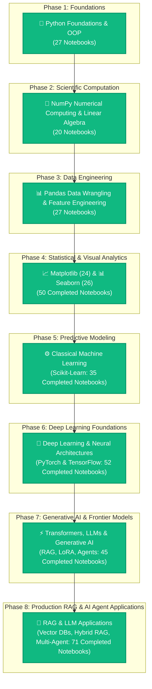

<div align="center">

# 🤖 Artificial Intelligence & Machine Learning Masterclass

### *A Comprehensive, Code-First Curriculum from Python Fundamentals to Production-Grade AI Architectures*

[](https://www.python.org/)
[](https://jupyter.org/)
[](https://numpy.org/)
[](https://pandas.pydata.org/)
[](https://seaborn.pydata.org/)
[](https://scikit-learn.org/)
[](https://pytorch.org/)
[](https://tensorflow.org/)
[](#-master-curriculum-breakdown)
[](#-roadmap--progress)
[](#-license)

<br/>

<p align="center">
  <b>327+ Hands-On Notebooks</b> • <b>Zero-to-Hero Roadmap</b> • <b>Real-World Capstone Projects</b> • <b>RAG, Agents & Production LLM Applications</b>
</p>

<p align="center">
  <a href="./Python/"><b>🐍 Python (27)</b></a> •
  <a href="./Numpy/"><b>🔢 NumPy (20)</b></a> •
  <a href="./Pandas/"><b>📊 Pandas (27)</b></a> •
  <a href="./Matplotlib/"><b>📈 Matplotlib (24)</b></a> •
  <a href="./Seaborn/"><b>📊 Seaborn (26)</b></a> •
  <a href="./Scikit-learn/"><b>⚙️ Scikit-Learn (35)</b></a> •
  <a href="./Deep-Learning/"><b>🧠 Deep Learning (52)</b></a> •
  <a href="./Transformers-and-Generative-AI/"><b>⚡ Transformers & GenAI (45)</b></a> •
  <a href="./RAG-and-LLM-Applications/"><b>🤖 RAG & LLM Apps (71)</b></a> •
  <a href="#-master-curriculum-breakdown"><b>📚 Notebook Index</b></a> •
  <a href="#-featured-capstone-projects"><b>🏆 Capstones</b></a>
</p>

</div>

---

## 📑 Table of Contents

- [📖 Curriculum Overview](#-curriculum-overview)
- [🌟 Key Educational Highlights](#-key-educational-highlights)
- [🗺️ Learning Pathway](#️-learning-pathway)
- [🎯 Tailored Learning Tracks](#-tailored-learning-tracks)
- [📚 Master Curriculum Breakdown](#-master-curriculum-breakdown)
  - [Module 1: 🐍 Python for AI & Data Science (27 Notebooks)](#module-1--python-for-ai--data-science-27-notebooks)
  - [Module 2: 🔢 NumPy Numerical Computing & Linear Algebra (20 Notebooks)](#module-2--numpy-numerical-computing--linear-algebra-20-notebooks)
  - [Module 3: 📊 Pandas Data Wrangling & Feature Engineering (27 Notebooks)](#module-3--pandas-data-wrangling--feature-engineering-27-notebooks)
  - [Module 4: 📈 Matplotlib for Data Visualization (24 Notebooks)](#module-4--matplotlib-for-data-visualization-24-notebooks)
  - [Module 5: 📊 Seaborn for Statistical Data Visualization (26 Notebooks)](#module-5--seaborn-for-statistical-data-visualization-26-notebooks)
  - [Module 6: ⚙️ Scikit-Learn for Machine Learning & Modeling (35 Notebooks)](#module-6--scikit-learn-for-machine-learning--modeling-35-notebooks)
  - [Module 7: 🧠 Deep Learning, PyTorch & TensorFlow (52 Notebooks)](#module-7--deep-learning-pytorch--tensorflow-52-notebooks)
  - [Module 8: ⚡ Transformers, LLMs & Generative AI (45 Notebooks)](#module-8--transformers-llms--generative-ai-45-notebooks)
  - [Module 9: 🤖 RAG & LLM Applications (71 Notebooks)](#module-9--rag--llm-applications-71-notebooks)
- [🏆 Featured Capstone Projects](#-featured-capstone-projects)
  - [1. 🎓 Student Academic Performance & Analytics Engine](#1--student-academic-performance--analytics-engine)
  - [2. 🏠 Vectorized Real Estate Valuation & EDA Pipeline](#2--vectorized-real-estate-valuation--eda-pipeline)
  - [3. 🛒 Global E-Commerce & Retail Intelligence Suite](#3--global-e-commerce--retail-intelligence-suite)
  - [4. 🌍 Global Health & Economic Development Analytics Dashboard](#4--global-health--economic-development-analytics-dashboard)
  - [5. 🏦 Financial Risk & Customer Credit Default Analytics Suite](#5--financial-risk--customer-credit-default-analytics-suite)
  - [6. 🎯 Enterprise Customer Churn & Lifetime Risk Predictive Pipeline](#6--enterprise-customer-churn--lifetime-risk-predictive-pipeline)
  - [7. 🌐 Autonomous Multi-Modal Diagnostic & Predictive Intelligence Suite](#7--autonomous-multi-modal-diagnostic--predictive-intelligence-suite)
  - [8. 🏢 Enterprise Knowledge Intelligence & Autonomous Agentic Platform](#8--enterprise-knowledge-intelligence--autonomous-agentic-platform)
  - [9. 🌐 Multi-Agent Enterprise Knowledge Intelligence Platform](#9--multi-agent-enterprise-knowledge-intelligence-platform)
- [⚡ Vectorization & Performance Benchmarks](#-vectorization--performance-benchmarks)
- [🗂️ Repository Architecture](#️-repository-architecture)
- [💻 Quickstart & Installation](#-quickstart--installation)
  - [Prerequisites](#prerequisites)
  - [Environment Setup (PowerShell / Bash / Conda)](#environment-setup-powershell--bash--conda)
  - [Launching Jupyter Notebook / JupyterLab](#launching-jupyter-notebook--jupyterlab)
- [🛠️ Tech Stack & Ecosystem](#️-tech-stack--ecosystem)
- [📐 Best Practices & Coding Philosophy](#-best-practices--coding-philosophy)
- [🎯 Roadmap & Progress](#-roadmap--progress)
- [❓ FAQ & Troubleshooting](#-faq--troubleshooting)
- [🤝 Contributing](#-contributing)
- [👤 Author & Acknowledgments](#-author--acknowledgments)
- [📜 License](#-license)

---

## 📖 Curriculum Overview

The **AI-ML-Learning** repository is an end-to-end, code-first educational masterclass designed to take software engineers, quantitative analysts, and aspiring data scientists from fundamental programming concepts to production-grade artificial intelligence and machine learning pipelines.

Rather than relying on abstract theory alone, every single concept is paired with an **interactive Jupyter Notebook** featuring:
- 💡 **Intuitive Theory Summaries**: Mathematical definitions, algorithmic intuition, and architectural breakdowns.
- 💻 **Live Executable Code Cells**: Real syntax demonstrations, edge cases, and standard library integrations.
- ⚡ **Performance Optimization**: Vectorized array computing, broadcasting rules, and memory management.
- 🧪 **Hands-On Practice Exercises**: Algorithm challenges, ETL scenarios, and interview-level problems.
- 🏢 **End-to-End Mini-Projects**: Capstone projects simulating production industry problems.

---

## 🌟 Key Educational Highlights

| Pillar | Focus | What You Will Learn |
| :--- | :--- | :--- |
| 🧩 **Zero-to-Hero Progression** | Systematic Learning | Step-by-step evolution from basic variable types to advanced matrix decompositions and relational joins. |
| ⚡ **C-Accelerated Vectorization** | High-Throughput Computing | Bypassing slow Python bytecode loops via NumPy universal functions (`ufuncs`) and memory strides. |
| 🔬 **Applied Mathematics** | Linear Algebra Foundations | Practical matrix multiplications (`@`), determinants, matrix inversions, and eigenvalue decompositions. |
| 🧹 **Production Data Wrangling** | Tabular Feature Engineering | Mastery of Pandas Series & DataFrames, split-apply-combine aggregations, multi-table joins, and temporal extraction. |
| 💼 **Portfolio Capstones** | Industry-Grade Applications | End-to-end projects covering object-oriented system design, housing EDA, and retail customer analytics. |
| 📁 **Clean & Modular Structure** | Best Practices | Fully documented notebooks with consistent naming, clean markdown styling, and standalone reproducibility. |

---

## 🗺️ Learning Pathway

The curriculum follows an intentional, battle-tested learning path engineered to establish rock-solid foundations before advancing to complex models:



---

## 🎯 Tailored Learning Tracks

Depending on your personal goals and experience level, choose the study path that fits you best:

<details open>
<summary><b>🎯 Track A: Data Analyst & BI Specialist Track</b></summary>
<br/>

Focuses on exploratory data manipulation, time-series analysis, aggregation metrics, and reporting:
1. **Python Essentials**: `01_python_introduction` → `11_dictionaries` → `16_file_handling` → `21_python_datetime`
2. **NumPy Fundamentals**: `01_numpy_introduction` → `05_numpy_slicing` → `09_numpy_aggregate_functions` → `10_numpy_filtering`
3. **Pandas Mastery (Full Suite)**: `01_pandas_introduction` through `25_pandas_optimization`
4. **Capstone**: [Global E-Commerce & Retail Intelligence Suite](./Pandas/27_pandas_mini_project.ipynb)

</details>

<details>
<summary><b>⚡ Track B: Machine Learning Engineer Track</b></summary>
<br/>

Focuses on mathematical rigor, vectorization, OOP system architecture, and feature engineering:
1. **Advanced Python**: `12_functions` → `18_object_oriented_programming` → `19_iterators_and_generators` → `20_decorators`
2. **NumPy Deep-Dive**: `06_numpy_arithmetic` → `07_broadcasting` → `13_array_attributes` → `17_copy_vs_view` → `18_linear_algebra`
3. **Pandas Transformation**: `08_pandas_filtering` → `13_groupby` → `15_merging` → `25_optimization`
4. **Capstones**: [Real Estate Valuation & EDA](./Numpy/20_numpy_mini_project.ipynb) & [Pandas Retail Analytics](./Pandas/27_pandas_mini_project.ipynb)

</details>

<details>
<summary><b>🚀 Track C: Speed-Run / Refresher Track</b></summary>
<br/>

For experienced developers seeking a quick, focused refresher of modern syntax and techniques:
- 🐍 [Python Practice Sets](./Python/26_python_practice.ipynb) & [Python Capstone](./Python/27_python_mini_project.ipynb)
- 🔢 [NumPy Linear Algebra](./Numpy/18_numpy_linear_algebra.ipynb) & [NumPy Capstone](./Numpy/20_numpy_mini_project.ipynb)
- 📊 [Pandas Optimization](./Pandas/25_pandas_optimization.ipynb) & [Pandas Capstone](./Pandas/27_pandas_mini_project.ipynb)

</details>

---

## 📚 Master Curriculum Breakdown

### Module 1: 🐍 Python for AI & Data Science (27 Notebooks)

> **Location:** [`./Python/`](./Python/) | **Module Guide:** [`Python/README.md`](./Python/README.md)

A comprehensive foundation in modern Python 3.8+ covering syntax, standard libraries, functional programming, and object-oriented architecture.

<details open>
<summary><b>Click to expand/collapse all 27 Python Notebooks</b></summary>

| # | Notebook | Core Topics & Capabilities Covered | Status |
| :-: | :--- | :--- | :-: |
| 01 | [`01_python_introduction.ipynb`](./Python/01_python_introduction.ipynb) | Environment setup, Python execution model, keywords, dynamic typing, comments | Completed ✅ |
| 02 | [`02_variables_and_data_types.ipynb`](./Python/02_variables_and_data_types.ipynb) | Primitive types (`int`, `float`, `str`, `bool`), explicit type casting, id/type inspection | Completed ✅ |
| 03 | [`03_input_and_output.ipynb`](./Python/03_input_and_output.ipynb) | `input()`, formatted f-strings, format specifiers, precision rounding, separators | Completed ✅ |
| 04 | [`04_operators.ipynb`](./Python/04_operators.ipynb) | Arithmetic, comparison, boolean logic, bitwise manipulation, operator precedence | Completed ✅ |
| 05 | [`05_conditional_statements.ipynb`](./Python/05_conditional_statements.ipynb) | `if-elif-else`, nested branching, ternary operators, Python 3.10 `match-case` | Completed ✅ |
| 06 | [`06_loops.ipynb`](./Python/06_loops.ipynb) | `for` and `while` loops, `break`, `continue`, `pass`, `enumerate()`, `zip()` | Completed ✅ |
| 07 | [`07_strings.ipynb`](./Python/07_strings.ipynb) | Immutability, slicing rules, methods (`split`, `join`, `strip`, `replace`), regex preview | Completed ✅ |
| 08 | [`08_lists.ipynb`](./Python/08_lists.ipynb) | Ordered mutability, indexing, list methods (`append`, `extend`, `sort`), shallow vs deep copy | Completed ✅ |
| 09 | [`09_tuples.ipynb`](./Python/09_tuples.ipynb) | Immutability, tuple packing/unpacking, performance benchmarks, `collections.namedtuple` | Completed ✅ |
| 10 | [`10_sets.ipynb`](./Python/10_sets.ipynb) | Unique hashing, set operations (union, intersection, symmetric difference), membership testing | Completed ✅ |
| 11 | [`11_dictionaries.ipynb`](./Python/11_dictionaries.ipynb) | Hash-map key-value lookups, `.get()`, dict comprehension, `defaultdict`, `Counter` | Completed ✅ |
| 12 | [`12_functions.ipynb`](./Python/12_functions.ipynb) | `def`, return semantics, positional/keyword args, `*args`, `**kwargs`, LEGB scope | Completed ✅ |
| 13 | [`13_lambda_functions.ipynb`](./Python/13_lambda_functions.ipynb) | Anonymous functions, `map()`, `filter()`, `reduce()`, custom key sorting | Completed ✅ |
| 14 | [`14_list_comprehension.ipynb`](./Python/14_list_comprehension.ipynb) | Comprehension syntax, conditional filtering, 2D matrix flattening, dict comprehensions | Completed ✅ |
| 15 | [`15_modules_and_packages.ipynb`](./Python/15_modules_and_packages.ipynb) | Module namespaces, `sys.path`, `__init__.py`, importing custom utility modules | Completed ✅ |
| 16 | [`16_file_handling.ipynb`](./Python/16_file_handling.ipynb) | Text & binary I/O, context managers (`with`), reading line-by-line, CSV ingestion | Completed ✅ |
| 17 | [`17_exception_handling.ipynb`](./Python/17_exception_handling.ipynb) | `try-except-else-finally` blocks, raising exceptions, defining custom exception hierarchies | Completed ✅ |
| 18 | [`18_object_oriented_programming.ipynb`](./Python/18_object_oriented_programming.ipynb) | Encapsulation, Abstraction, Inheritance, Polymorphism, `__init__`, `@property`, dunder methods | Completed ✅ |
| 19 | [`19_iterators_and_generators.ipynb`](./Python/19_iterators_and_generators.ipynb) | Iteration protocol (`__iter__`, `__next__`), `yield` keyword, stateful memory-saving generators | Completed ✅ |
| 20 | [`20_decorators.ipynb`](./Python/20_decorators.ipynb) | First-class functions, closures, execution timing `@timer`, argument logging decorators | Completed ✅ |
| 21 | [`21_python_datetime.ipynb`](./Python/21_python_datetime.ipynb) | `datetime`, `date`, `timedelta`, `strftime` formatting, `strptime` parsing, timezone awareness | Completed ✅ |
| 22 | [`22_python_regular_expressions.ipynb`](./Python/22_python_regular_expressions.ipynb) | Regex patterns with `re`, meta-characters, `search`, `match`, `findall`, `sub`, capture groups | Completed ✅ |
| 23 | [`23_python_json.ipynb`](./Python/23_python_json.ipynb) | JSON serialization (`dumps`, `loads`), reading/writing JSON files, nested payload parsing | Completed ✅ |
| 24 | [`24_python_numpy_intro.ipynb`](./Python/24_python_numpy_intro.ipynb) | Transition bridge: Python nested lists vs. contiguous NumPy arrays, performance benchmarks | Completed ✅ |
| 25 | [`25_python_pandas_intro.ipynb`](./Python/25_python_pandas_intro.ipynb) | Transition bridge: Python dictionaries to 2D tabular Pandas Series and DataFrames | Completed ✅ |
| 26 | [`26_python_practice.ipynb`](./Python/26_python_practice.ipynb) | 10 Comprehensive problem challenges spanning algorithms, data structures, and edge cases | Completed ✅ |
| 27 | [`27_python_mini_project.ipynb`](./Python/27_python_mini_project.ipynb) | **Capstone:** Object-Oriented Student Performance & Academic Records Analytics Engine | Completed ✅ |

</details>

---

### Module 2: 🔢 NumPy Numerical Computing & Linear Algebra (20 Notebooks)

> **Location:** [`./Numpy/`](./Numpy/) | **Module Guide:** [`Numpy/README.md`](./Numpy/README.md)

A rigorous masterclass in $N$-dimensional array computation, universal functions, broadcasting mechanics, and linear algebra routines powering modern ML.

<details open>
<summary><b>Click to expand/collapse all 20 NumPy Notebooks</b></summary>

| # | Notebook | Core Topics & Capabilities Covered | Status |
| :-: | :--- | :--- | :-: |
| 01 | [`01_numpy_introduction.ipynb`](./Numpy/01_numpy_introduction.ipynb) | C-contiguous array allocations, ndarray architecture, performance speedups vs. lists | Completed ✅ |
| 02 | [`02_numpy_data_types.ipynb`](./Numpy/02_numpy_data_types.ipynb) | Dtypes (`int8/32/64`, `float32/64`, `complex`, `bool`), explicit casting via `.astype()` | Completed ✅ |
| 03 | [`03_numpy_multidimensional_arrays.ipynb`](./Numpy/03_numpy_multidimensional_arrays.ipynb) | 1D vectors, 2D matrices, 3D+ tensors, `.ndim`, `.shape`, `.size`, multi-axis indexing | Completed ✅ |
| 04 | [`04_numpy_reshape.ipynb`](./Numpy/04_numpy_reshape.ipynb) | Reshaping dimensions, auto-dimension inference (`-1`), `.ravel()` vs. `.flatten()` | Completed ✅ |
| 05 | [`05_numpy_slicing.ipynb`](./Numpy/05_numpy_slicing.ipynb) | Sub-array extractions, step strides, multi-dimensional slicing `[row_slice, col_slice]` | Completed ✅ |
| 06 | [`06_numpy_arithmetic.ipynb`](./Numpy/06_numpy_arithmetic.ipynb) | Element-wise vectorized math, arithmetic operators, power, modulus, scalar interactions | Completed ✅ |
| 07 | [`07_numpy_broadcasting.ipynb`](./Numpy/07_numpy_broadcasting.ipynb) | Broadcasting rules, compatibility dimensions, virtual expansion without memory copying | Completed ✅ |
| 08 | [`08_numpy_useful_functions.ipynb`](./Numpy/08_numpy_useful_functions.ipynb) | Initialization helpers (`zeros`, `ones`, `full`, `arange`, `linspace`, `eye`, `identity`) | Completed ✅ |
| 09 | [`09_numpy_aggregate_functions.ipynb`](./Numpy/09_numpy_aggregate_functions.ipynb) | Reduction aggregations (`sum`, `mean`, `std`, `var`, `min`, `max`), directional `axis=0` vs `axis=1` | Completed ✅ |
| 10 | [`10_numpy_filtering.ipynb`](./Numpy/10_numpy_filtering.ipynb) | Boolean condition masking, `np.where()` ternary selection, `np.extract()`, `np.nonzero()` | Completed ✅ |
| 11 | [`11_numpy_random_numbers.ipynb`](./Numpy/11_numpy_random_numbers.ipynb) | `np.random` engine, seeding, uniform (`rand`), standard normal (`randn`), discrete (`randint`) | Completed ✅ |
| 12 | [`12_numpy_saving_loading.ipynb`](./Numpy/12_numpy_saving_loading.ipynb) | High-speed binary disk serialization (`.npy`, compressed `.npz`), text saving via `savetxt` | Completed ✅ |
| 13 | [`13_numpy_array_attributes.ipynb`](./Numpy/13_numpy_array_attributes.ipynb) | Low-level array attributes (`itemsize`, `nbytes`, `strides`, memory flags, C-contiguous check) | Completed ✅ |
| 14 | [`14_numpy_joining_arrays.ipynb`](./Numpy/14_numpy_joining_arrays.ipynb) | Array concatenation, vertical stacking (`vstack`), horizontal stacking (`hstack`), `column_stack` | Completed ✅ |
| 15 | [`15_numpy_splitting_arrays.ipynb`](./Numpy/15_numpy_splitting_arrays.ipynb) | Partitioning tensors, `split`, `hsplit`, `vsplit`, handling uneven partitions with `array_split` | Completed ✅ |
| 16 | [`16_numpy_sorting_searching.ipynb`](./Numpy/16_numpy_sorting_searching.ipynb) | In-place vs return sorting, index sorting with `argsort()`, `searchsorted()`, `unique()` | Completed ✅ |
| 17 | [`17_numpy_copy_vs_view.ipynb`](./Numpy/17_numpy_copy_vs_view.ipynb) | Memory safety: shallow views (`.view()`, `.base`) vs deep detached copies (`.copy()`) | Completed ✅ |
| 18 | [`18_numpy_linear_algebra.ipynb`](./Numpy/18_numpy_linear_algebra.ipynb) | Matrix products (`@`, `np.dot`), matrix transpose (`.T`), determinants, inverse (`inv`), eigenvalues | Completed ✅ |
| 19 | [`19_numpy_practice.ipynb`](./Numpy/19_numpy_practice.ipynb) | Vectorized array transformations, Z-score standardization, Min-Max normalization, outlier masks | Completed ✅ |
| 20 | [`20_numpy_mini_project.ipynb`](./Numpy/20_numpy_mini_project.ipynb) | **Capstone:** High-Performance Vectorized Real Estate Valuation & EDA Pipeline | Completed ✅ |

</details>

---

### Module 3: 📊 Pandas Data Wrangling & Feature Engineering (27 Notebooks)

> **Location:** [`./Pandas/`](./Pandas/) | **Module Guide:** [`Pandas/README.md`](./Pandas/README.md)

A production-grade masterclass in tabular data cleaning, relational joins, time-series feature engineering, and memory optimization.

<details open>
<summary><b>Click to expand/collapse all 27 Pandas Notebooks</b></summary>

| # | Notebook | Core Topics & Capabilities Covered | Status |
| :-: | :--- | :--- | :-: |
| 01 | [`01_pandas_introduction.ipynb`](./Pandas/01_pandas_introduction.ipynb) | Pandas tabular architecture, NumPy relationship, importance in AI/ML feature pipelines | Completed ✅ |
| 02 | [`02_pandas_series.ipynb`](./Pandas/02_pandas_series.ipynb) | 1D labeled Series, index mapping, scalar operations, alignment properties | Completed ✅ |
| 03 | [`03_pandas_dataframe.ipynb`](./Pandas/03_pandas_dataframe.ipynb) | 2D DataFrame anatomy, columns, row index, construction from dicts, lists, and arrays | Completed ✅ |
| 04 | [`04_pandas_reading_data.ipynb`](./Pandas/04_pandas_reading_data.ipynb) | Ingestion from CSV, TSV, JSON, and Excel, setting index columns, handling encodings | Completed ✅ |
| 05 | [`05_pandas_inspecting_data.ipynb`](./Pandas/05_pandas_inspecting_data.ipynb) | Quick inspection via `head()`, `tail()`, `info()`, `describe()`, `.shape`, `.dtypes`, `memory_usage()` | Completed ✅ |
| 06 | [`06_pandas_data_selection.ipynb`](./Pandas/06_pandas_data_selection.ipynb) | Column extraction (bracket vs. dot notation), multiple column slicing, series projection | Completed ✅ |
| 07 | [`07_pandas_indexing_and_slicing.ipynb`](./Pandas/07_pandas_indexing_and_slicing.ipynb) | Explicit label indexing with `.loc[]` vs zero-indexed positional slicing with `.iloc[]` | Completed ✅ |
| 08 | [`08_pandas_filtering.ipynb`](./Pandas/08_pandas_filtering.ipynb) | Complex boolean masking, compound operators (`&`, `\|`, `~`), `.isin()`, expressive `.query()` | Completed ✅ |
| 09 | [`09_pandas_adding_modifying_columns.ipynb`](./Pandas/09_pandas_adding_modifying_columns.ipynb) | Feature generation, vectorized mathematical columns, conditional assignment with `np.where` | Completed ✅ |
| 10 | [`10_pandas_handling_missing_values.ipynb`](./Pandas/10_pandas_handling_missing_values.ipynb) | Null detection (`isna()`), dropping rows/cols (`dropna()`), imputation methods (`fillna`, interpolation) | Completed ✅ |
| 11 | [`11_pandas_handling_duplicates.ipynb`](./Pandas/11_pandas_handling_duplicates.ipynb) | Duplicate row identification with `.duplicated()`, deduplication via `.drop_duplicates(subset=...)` | Completed ✅ |
| 12 | [`12_pandas_sorting.ipynb`](./Pandas/12_pandas_sorting.ipynb) | Single and multi-column sorting (`sort_values()`), index sorting, handling null placement | Completed ✅ |
| 13 | [`13_pandas_groupby.ipynb`](./Pandas/13_pandas_groupby.ipynb) | Split-Apply-Combine paradigm, single & multi-key grouping, group iteration, dictionary keys | Completed ✅ |
| 14 | [`14_pandas_aggregation.ipynb`](./Pandas/14_pandas_aggregation.ipynb) | Multi-metric named aggregations with `.agg()`, custom aggregator functions, `.transform()` broadcasting | Completed ✅ |
| 15 | [`15_pandas_merging_and_joining.ipynb`](./Pandas/15_pandas_merging_and_joining.ipynb) | Relational SQL-style operations (`inner`, `left`, `right`, `outer`), single and composite join keys | Completed ✅ |
| 16 | [`16_pandas_concatenation.ipynb`](./Pandas/16_pandas_concatenation.ipynb) | Concatenating along rows (`axis=0`) and columns (`axis=1`), handling overlapping indices | Completed ✅ |
| 17 | [`17_pandas_apply_map_lambda.ipynb`](./Pandas/17_pandas_apply_map_lambda.ipynb) | Row/column functional mappings with `.apply()`, element-wise transforms with `.map()` | Completed ✅ |
| 18 | [`18_pandas_string_operations.ipynb`](./Pandas/18_pandas_string_operations.ipynb) | Vectorized text methods (`.str.lower()`, `.contains()`, `.extract()`, `.split()`, whitespace trimming) | Completed ✅ |
| 19 | [`19_pandas_datetime.ipynb`](./Pandas/19_pandas_datetime.ipynb) | `pd.to_datetime()` parsing, `.dt` accessor (year, month, day, dayofweek), date offsetting | Completed ✅ |
| 20 | [`20_pandas_renaming_and_replacing.ipynb`](./Pandas/20_pandas_renaming_and_replacing.ipynb) | Standardizing column headers via `.rename()`, value substitutions with `.replace()` maps | Completed ✅ |
| 21 | [`21_pandas_pivot_tables.ipynb`](./Pandas/21_pandas_pivot_tables.ipynb) | Multidimensional cross-analysis with `.pivot_table()`, hierarchical columns, subtotal margins | Completed ✅ |
| 22 | [`22_pandas_crosstab.ipynb`](./Pandas/22_pandas_crosstab.ipynb) | Categorical frequency distributions, two-way contingency tables, percentage normalization | Completed ✅ |
| 23 | [`23_pandas_statistical_functions.ipynb`](./Pandas/23_pandas_statistical_functions.ipynb) | Quantiles, covariance (`cov()`), Pearson correlation matrix (`corr()`), skewness, kurtosis | Completed ✅ |
| 24 | [`24_pandas_exporting_data.ipynb`](./Pandas/24_pandas_exporting_data.ipynb) | Serialization to CSV, JSON, formatted Excel, and high-performance columnar Apache Parquet | Completed ✅ |
| 25 | [`25_pandas_optimization.ipynb`](./Pandas/25_pandas_optimization.ipynb) | Memory profiling, numerical downcasting, categorical string encoding, chunked batch streaming | Completed ✅ |
| 26 | [`26_pandas_practice.ipynb`](./Pandas/26_pandas_practice.ipynb) | 10 Real-world data wrangling and ETL engineering challenges spanning diverse domains | Completed ✅ |
| 27 | [`27_pandas_mini_project.ipynb`](./Pandas/27_pandas_mini_project.ipynb) | **Capstone:** End-to-End Global E-Commerce & Retail Sales Intelligence Pipeline | Completed ✅ |

</details>

---

### Module 4: 📈 Matplotlib for Data Visualization (24 Notebooks)

> **Location:** [`./Matplotlib/`](./Matplotlib/) | **Module Guide:** [`Matplotlib/README.md`](./Matplotlib/README.md)

A production-grade masterclass in data visualization, Object-Oriented plotting (`fig, ax`), statistical distributions, multi-panel `GridSpec` dashboards, and 3D spatial surfaces.

<details open>
<summary><b>Click to expand/collapse all 24 Matplotlib Notebooks</b></summary>

| # | Notebook | Core Topics & Capabilities Covered | Status |
| :-: | :--- | :--- | :-: |
| 01 | [`01_matplotlib_introduction.ipynb`](./Matplotlib/01_matplotlib_introduction.ipynb) | Pyplot procedural vs Object-Oriented (`fig, ax`), figure anatomy, inline rendering | Completed ✅ |
| 02 | [`02_matplotlib_figure_and_axes.ipynb`](./Matplotlib/02_matplotlib_figure_and_axes.ipynb) | Canvas dimensions (`figsize`, `dpi`), `add_subplot` vs `add_axes`, Inset magnification plots | Completed ✅ |
| 03 | [`03_matplotlib_line_plot.ipynb`](./Matplotlib/03_matplotlib_line_plot.ipynb) | Continuous trends, linestyles, colors, ML training loss vs validation loss curves, log scaling | Completed ✅ |
| 04 | [`04_matplotlib_bar_chart.ipynb`](./Matplotlib/04_matplotlib_bar_chart.ipynb) | Vertical bars, categorical metrics, `ax.bar_label()` value labels, clustered/grouped comparisons | Completed ✅ |
| 05 | [`05_matplotlib_horizontal_bar_chart.ipynb`](./Matplotlib/05_matplotlib_horizontal_bar_chart.ipynb) | Long category labels, `ax.barh()`, `ax.invert_yaxis()`, Machine Learning Feature Importance | Completed ✅ |
| 06 | [`06_matplotlib_scatter_plot.ipynb`](./Matplotlib/06_matplotlib_scatter_plot.ipynb) | Pairwise correlation, 4D bubble scatter (X, Y, size, color), colorbars, K-Means cluster overlays | Completed ✅ |
| 07 | [`07_matplotlib_histogram.ipynb`](./Matplotlib/07_matplotlib_histogram.ipynb) | Continuous data distribution, binning strategies, `density=True`, Gaussian bell curve overlays | Completed ✅ |
| 08 | [`08_matplotlib_pie_chart.ipynb`](./Matplotlib/08_matplotlib_pie_chart.ipynb) | Part-to-whole proportions, `autopct` formatting, exploded wedges, modern Donut charts | Completed ✅ |
| 09 | [`09_matplotlib_box_plot.ipynb`](./Matplotlib/09_matplotlib_box_plot.ipynb) | Five-number summary (Min, Q1, Median, Q3, Max), IQR outlier fliers, cross-validation model scores | Completed ✅ |
| 10 | [`10_matplotlib_subplots.ipynb`](./Matplotlib/10_matplotlib_subplots.ipynb) | `plt.subplots(nrows, ncols)`, 2D axes iteration with `axes.flat`, shared axes, `GridSpec` layouts | Completed ✅ |
| 11 | [`11_matplotlib_titles_labels_and_legends.ipynb`](./Matplotlib/11_matplotlib_titles_labels_and_legends.ipynb) | LaTeX math typesetting ($R^2$, $\sigma$), typography, `loc`, `bbox_to_anchor`, external legends | Completed ✅ |
| 12 | [`12_matplotlib_colors_and_styles.ipynb`](./Matplotlib/12_matplotlib_colors_and_styles.ipynb) | `plt.style.available`, `seaborn-v0_8`, `dark_background`, colormaps (`viridis`, `coolwarm`), correlation heatmaps | Completed ✅ |
| 13 | [`13_matplotlib_markers_and_linestyles.ipynb`](./Matplotlib/13_matplotlib_markers_and_linestyles.ipynb) | Marker types (`o`, `s`, `^`, `D`, `*`), face/edge colors (`mfc`, `mec`), stepped lines (`steps-post`) | Completed ✅ |
| 14 | [`14_matplotlib_grid_and_ticks.ipynb`](./Matplotlib/14_matplotlib_grid_and_ticks.ipynb) | Major & minor grids, `MultipleLocator`, `PercentFormatter`, Dual-Axis charts with `ax.twinx()` | Completed ✅ |
| 15 | [`15_matplotlib_annotations.ipynb`](./Matplotlib/15_matplotlib_annotations.ipynb) | Precision pointers (`ax.annotate`), arrow styles, reference thresholds (`ax.axhline`, `ax.axvspan`) | Completed ✅ |
| 16 | [`16_matplotlib_customization.ipynb`](./Matplotlib/16_matplotlib_customization.ipynb) | Edward Tufte minimal data-ink ratio, removing spines, global configuration with `plt.rcParams` | Completed ✅ |
| 17 | [`17_matplotlib_fill_and_area_plots.ipynb`](./Matplotlib/17_matplotlib_fill_and_area_plots.ipynb) | `ax.fill_between()`, 95% confidence intervals around forecasts, conditional profit/loss shading | Completed ✅ |
| 18 | [`18_matplotlib_stacked_bar_chart.ipynb`](./Matplotlib/18_matplotlib_stacked_bar_chart.ipynb) | Vertical stacked bars with `bottom`, horizontal with `left`, 100% normalized proportional bars | Completed ✅ |
| 19 | [`19_matplotlib_error_bars.ipynb`](./Matplotlib/19_matplotlib_error_bars.ipynb) | Experimental uncertainty, symmetric vs asymmetric error bounds (`yerr`, `xerr`), cap customization | Completed ✅ |
| 20 | [`20_matplotlib_date_and_time_plots.ipynb`](./Matplotlib/20_matplotlib_date_and_time_plots.ipynb) | Time series plotting, `matplotlib.dates`, `DateFormatter`, `fig.autofmt_xdate()`, moving average crossovers | Completed ✅ |
| 21 | [`21_matplotlib_3d_plots.ipynb`](./Matplotlib/21_matplotlib_3d_plots.ipynb) | `mplot3d` toolkit, 3D scatter, 3D parametric trajectories, loss surface plots with `ax.plot_surface()` | Completed ✅ |
| 22 | [`22_matplotlib_saving_and_exporting.ipynb`](./Matplotlib/22_matplotlib_saving_and_exporting.ipynb) | Production exporting (`fig.savefig`), vector (PDF/SVG) vs raster (PNG/JPG), `dpi=300`, `bbox_inches='tight'` | Completed ✅ |
| 23 | [`23_matplotlib_practice.ipynb`](./Matplotlib/23_matplotlib_practice.ipynb) | 10 Comprehensive multi-domain problem sets with complete code implementations | Completed ✅ |
| 24 | [`24_matplotlib_mini_project.ipynb`](./Matplotlib/24_matplotlib_mini_project.ipynb) | **Capstone:** Global Economic & Public Health Analytics Dashboard (Gapminder-style visualization suite) | Completed ✅ |

</details>

---

### Module 5: 📊 Seaborn for Statistical Data Visualization (26 Notebooks)

> **Location:** [`./Seaborn/`](./Seaborn/) | **Module Guide:** [`Seaborn/README.md`](./Seaborn/README.md)

A production-grade masterclass in statistical visualization, multi-dimensional distributions, categorical modeling, correlation heatmaps, and exploratory data analysis.

<details open>
<summary><b>Click to expand/collapse all 26 Seaborn Notebooks</b></summary>

| # | Notebook | Core Topics & Capabilities Covered | Status |
| :-: | :--- | :--- | :-: |
| 01 | [`01_seaborn_introduction.ipynb`](./Seaborn/01_seaborn_introduction.ipynb) | Why Seaborn for AI/ML, DataFrame integration, Matplotlib comparison, first multi-dimensional scatter | Completed ✅ |
| 02 | [`02_seaborn_installation_and_setup.ipynb`](./Seaborn/02_seaborn_installation_and_setup.ipynb) | Axes-level vs. Figure-level functions, embedding with `ax=ax`, `FacetGrid` returns, global themes | Completed ✅ |
| 03 | [`03_seaborn_datasets.ipynb`](./Seaborn/03_seaborn_datasets.ipynb) | Built-in datasets (`tips`, `iris`, `titanic`, `diamonds`, `penguins`), Tidy wide-form to long-form reshaping | Completed ✅ |
| 04 | [`04_seaborn_relational_plots.ipynb`](./Seaborn/04_seaborn_relational_plots.ipynb) | `sns.relplot()`, `kind='scatter'` vs `kind='line'`, multi-panel faceting with `col`, `row`, `col_wrap` | Completed ✅ |
| 05 | [`05_seaborn_scatter_plot.ipynb`](./Seaborn/05_seaborn_scatter_plot.ipynb) | `sns.scatterplot()`, multidimensional mapping: `hue`, `size`, `sizes=(min, max)`, `style`, alpha transparency | Completed ✅ |
| 06 | [`06_seaborn_line_plot.ipynb`](./Seaborn/06_seaborn_line_plot.ipynb) | `sns.lineplot()`, time series, automatic aggregation, 95% bootstrap confidence bands (`errorbar='ci'`), `markers` | Completed ✅ |
| 07 | [`07_seaborn_categorical_plots.ipynb`](./Seaborn/07_seaborn_categorical_plots.ipynb) | `sns.catplot()`, categorical scatter, distribution and estimate plot families, column faceting | Completed ✅ |
| 08 | [`08_seaborn_bar_plot.ipynb`](./Seaborn/08_seaborn_bar_plot.ipynb) | `sns.barplot()`, point estimates with confidence intervals, custom aggregators (`estimator=np.median`), `hue` | Completed ✅ |
| 09 | [`09_seaborn_count_plot.ipynb`](./Seaborn/09_seaborn_count_plot.ipynb) | `sns.countplot()`, frequency counts for discrete categories, ordering categories, horizontal bars | Completed ✅ |
| 10 | [`10_seaborn_box_plot.ipynb`](./Seaborn/10_seaborn_box_plot.ipynb) | `sns.boxplot()`, statistical quartiles, IQR outlier detection, nested subgroup comparisons with `hue` | Completed ✅ |
| 11 | [`11_seaborn_violin_plot.ipynb`](./Seaborn/11_seaborn_violin_plot.ipynb) | `sns.violinplot()`, combining box plot with KDE density estimation, `split=True` for binary cohorts, `inner='quartile'` | Completed ✅ |
| 12 | [`12_seaborn_strip_and_swarm_plot.ipynb`](./Seaborn/12_seaborn_strip_and_swarm_plot.ipynb) | `sns.stripplot()`, jitter, `sns.swarmplot()`, non-overlapping points, hybrid layering over box plots | Completed ✅ |
| 13 | [`13_seaborn_distribution_plots.ipynb`](./Seaborn/13_seaborn_distribution_plots.ipynb) | `sns.displot()`, univariate & bivariate distributions, toggling `kind='hist'`, `'kde'`, `'ecdf'` with faceting | Completed ✅ |
| 14 | [`14_seaborn_histogram_and_kde.ipynb`](./Seaborn/14_seaborn_histogram_and_kde.ipynb) | `sns.histplot()`, `kde=True`, `stat='density'`, `multiple='dodge'`, 2D Bivariate density contours (`sns.kdeplot`) | Completed ✅ |
| 15 | [`15_seaborn_ecdf_plot.ipynb`](./Seaborn/15_seaborn_ecdf_plot.ipynb) | `sns.ecdfplot()`, Empirical Cumulative Distribution Functions, percentile cutoffs, comparing cohort CDFs | Completed ✅ |
| 16 | [`16_seaborn_regression_plots.ipynb`](./Seaborn/16_seaborn_regression_plots.ipynb) | `sns.regplot()` vs `sns.lmplot()`, linear & 2nd-order polynomial fits, logistic regression (`logistic=True`) | Completed ✅ |
| 17 | [`17_seaborn_heatmap.ipynb`](./Seaborn/17_seaborn_heatmap.ipynb) | `sns.heatmap()`, Pearson correlation matrices, `annot=True`, `mask` upper triangle with `np.triu`, `clustermap` | Completed ✅ |
| 18 | [`18_seaborn_pairplot.ipynb`](./Seaborn/18_seaborn_pairplot.ipynb) | `sns.pairplot()`, pairwise relationship scatter matrices across all numerical features, `corner=True`, `hue` | Completed ✅ |
| 19 | [`19_seaborn_jointplot.ipynb`](./Seaborn/19_seaborn_jointplot.ipynb) | `sns.jointplot()`, bivariate relationship with marginal univariate distributions, `kind='scatter'`, `'hex'`, `'reg'` | Completed ✅ |
| 20 | [`20_seaborn_facetgrid.ipynb`](./Seaborn/20_seaborn_facetgrid.ipynb) | `sns.FacetGrid`, mapping arbitrary functions with `.map()` and `.map_dataframe()`, custom titles & labels | Completed ✅ |
| 21 | [`21_seaborn_pairgrid.ipynb`](./Seaborn/21_seaborn_pairgrid.ipynb) | `sns.PairGrid`, granular mapping: `.map_diag()` for KDE, `.map_upper()` for scatter, `.map_lower()` for contours | Completed ✅ |
| 22 | [`22_seaborn_themes_and_styles.ipynb`](./Seaborn/22_seaborn_themes_and_styles.ipynb) | 5 Styles (`darkgrid`, `whitegrid`, `ticks`), scaling with `set_context()`, `sns.despine()` border removal | Completed ✅ |
| 23 | [`23_seaborn_color_palettes.ipynb`](./Seaborn/23_seaborn_color_palettes.ipynb) | Qualitative (`deep`, `Set2`), Sequential (`Blues`, `rocket`), Diverging (`vlag`, `coolwarm`), `palplot` | Completed ✅ |
| 24 | [`24_seaborn_figure_customization.ipynb`](./Seaborn/24_seaborn_figure_customization.ipynb) | Interfacing Seaborn with Matplotlib `Axes` & `Figure`, custom titles, legends, and export (`dpi=300`) | Completed ✅ |
| 25 | [`25_seaborn_practice.ipynb`](./Seaborn/25_seaborn_practice.ipynb) | 10 Comprehensive multi-domain statistical EDA and Machine Learning visualization problem sets | Completed ✅ |
| 26 | [`26_seaborn_mini_project.ipynb`](./Seaborn/26_seaborn_mini_project.ipynb) | **Capstone:** Financial Risk & Credit Default Analytics Suite (Exploratory Data Analysis & Modeling) | Completed ✅ |

</details>

---

### Module 6: ⚙️ Scikit-Learn for Machine Learning & Modeling (35 Notebooks)

> **Location:** [`./Scikit-learn/`](./Scikit-learn/) | **Module Guide:** [`Scikit-learn/README.md`](./Scikit-learn/README.md)

A production-grade masterclass in classical machine learning, data preprocessing, regression, classification, unsupervised clustering, dimensionality reduction, cross-validation, and production pipelines.

<details open>
<summary><b>Click to expand/collapse all 35 Scikit-Learn Notebooks</b></summary>

| # | Notebook | Core Topics & Capabilities Covered | Status |
| :-: | :--- | :--- | :-: |
| 01 | [`01_scikit_learn_introduction.ipynb`](./Scikit-learn/01_scikit_learn_introduction.ipynb) | Scikit-learn architecture, Estimator API (`fit`, `predict`, `score`), conventions | Completed ✅ |
| 02 | [`02_machine_learning_workflow.ipynb`](./Scikit-learn/02_machine_learning_workflow.ipynb) | 5-stage ML lifecycle: data collection, splitting, preprocessing, modeling, evaluation | Completed ✅ |
| 03 | [`03_loading_datasets.ipynb`](./Scikit-learn/03_loading_datasets.ipynb) | Toy datasets (`iris`, `diabetes`), OpenML fetching, synthetic data generators (`make_classification`) | Completed ✅ |
| 04 | [`04_features_and_labels.ipynb`](./Scikit-learn/04_features_and_labels.ipynb) | Feature matrix $X$ ($N \times P$) vs target vector $y$, continuous vs discrete targets | Completed ✅ |
| 05 | [`05_train_test_split.ipynb`](./Scikit-learn/05_train_test_split.ipynb) | `train_test_split`, `stratify` parameter for class preservation, reproducibility seeding | Completed ✅ |
| 06 | [`06_data_preprocessing.ipynb`](./Scikit-learn/06_data_preprocessing.ipynb) | Transformer API, `fit_transform` on train vs `transform` on test, preventing leakage | Completed ✅ |
| 07 | [`07_handling_missing_values.ipynb`](./Scikit-learn/07_handling_missing_values.ipynb) | Imputation strategies: `SimpleImputer` (mean/median/mode), `KNNImputer` distance weights | Completed ✅ |
| 08 | [`08_encoding_categorical_data.ipynb`](./Scikit-learn/08_encoding_categorical_data.ipynb) | `OneHotEncoder`, `OrdinalEncoder`, `LabelEncoder`, handling unseen test categories | Completed ✅ |
| 09 | [`09_feature_scaling.ipynb`](./Scikit-learn/09_feature_scaling.ipynb) | `StandardScaler` (Z-score), `MinMaxScaler` (0-1), `RobustScaler` (median & IQR outliers) | Completed ✅ |
| 10 | [`10_feature_selection.ipynb`](./Scikit-learn/10_feature_selection.ipynb) | Filter methods (`SelectKBest`, ANOVA F-test), Recursive Feature Elimination (`RFE`) | Completed ✅ |
| 11 | [`11_linear_regression.ipynb`](./Scikit-learn/11_linear_regression.ipynb) | Ordinary Least Squares (OLS), slope `coef_`, intercept `intercept_`, $R^2$ score | Completed ✅ |
| 12 | [`12_multiple_linear_regression.ipynb`](./Scikit-learn/12_multiple_linear_regression.ipynb) | Multicollinearity, Ridge regression ($L_2$), Lasso regression ($L_1$) feature pruning | Completed ✅ |
| 13 | [`13_polynomial_regression.ipynb`](./Scikit-learn/13_polynomial_regression.ipynb) | `PolynomialFeatures`, interaction terms, Bias-Variance tradeoff visualization | Completed ✅ |
| 14 | [`14_logistic_regression.ipynb`](./Scikit-learn/14_logistic_regression.ipynb) | Binary classification, Sigmoid curve, `predict_proba()`, decision threshold tuning | Completed ✅ |
| 15 | [`15_knn_classification.ipynb`](./Scikit-learn/15_knn_classification.ipynb) | Non-parametric instance learning, Euclidean distance, $k$-neighbor optimization curve | Completed ✅ |
| 16 | [`16_decision_tree.ipynb`](./Scikit-learn/16_decision_tree.ipynb) | CART trees, Gini impurity vs Entropy, tree pruning (`max_depth`), `plot_tree` flowcharts | Completed ✅ |
| 17 | [`17_random_forest.ipynb`](./Scikit-learn/17_random_forest.ipynb) | Bootstrap Aggregation (Bagging), feature subspacing, Out-Of-Bag (`oob_score_`) error | Completed ✅ |
| 18 | [`18_support_vector_machine.ipynb`](./Scikit-learn/18_support_vector_machine.ipynb) | Support vectors, maximum margin hyperplanes, Kernel Trick (Linear, RBF, Polynomial) | Completed ✅ |
| 19 | [`19_naive_bayes.ipynb`](./Scikit-learn/19_naive_bayes.ipynb) | Bayes' Theorem, feature independence assumption, `GaussianNB` continuous probabilities | Completed ✅ |
| 20 | [`20_gradient_boosting.ipynb`](./Scikit-learn/20_gradient_boosting.ipynb) | Sequential boosting on pseudo-residuals, learning rate shrinkage, loss reduction curve | Completed ✅ |
| 21 | [`21_k_means_clustering.ipynb`](./Scikit-learn/21_k_means_clustering.ipynb) | Centroid clustering, inertia metric, Elbow Method heuristic, Silhouette coefficient | Completed ✅ |
| 22 | [`22_hierarchical_clustering.ipynb`](./Scikit-learn/22_hierarchical_clustering.ipynb) | Agglomerative hierarchical clustering, Ward/complete linkage, dendrogram visualization | Completed ✅ |
| 23 | [`23_dbscan_clustering.ipynb`](./Scikit-learn/23_dbscan_clustering.ipynb) | Density-based spatial clustering, core/border points, arbitrary geometry, noise detection | Completed ✅ |
| 24 | [`24_pca_dimensionality_reduction.ipynb`](./Scikit-learn/24_pca_dimensionality_reduction.ipynb) | Principal Component Analysis, eigenvalue variance decomposition, Scree plots | Completed ✅ |
| 25 | [`25_model_evaluation.ipynb`](./Scikit-learn/25_model_evaluation.ipynb) | Generalization error, overfitting vs underfitting diagnosis, train/validation curves | Completed ✅ |
| 26 | [`26_confusion_matrix.ipynb`](./Scikit-learn/26_confusion_matrix.ipynb) | TP, FP, TN, FN analysis, Type I / Type II error rates, `ConfusionMatrixDisplay` | Completed ✅ |
| 27 | [`27_classification_metrics.ipynb`](./Scikit-learn/27_classification_metrics.ipynb) | Precision, Recall, F1-Score, Balanced Accuracy, ROC-AUC, Precision-Recall curves | Completed ✅ |
| 28 | [`28_regression_metrics.ipynb`](./Scikit-learn/28_regression_metrics.ipynb) | Mean Absolute Error (MAE), Mean Squared Error (MSE), Root MSE (RMSE), $R^2$ score | Completed ✅ |
| 29 | [`29_cross_validation.ipynb`](./Scikit-learn/29_cross_validation.ipynb) | K-Fold, Stratified K-Fold cross-validation, `cross_val_score`, variance reduction | Completed ✅ |
| 30 | [`30_hyperparameter_tuning.ipynb`](./Scikit-learn/30_hyperparameter_tuning.ipynb) | Estimator parameters vs hyperparameters, validation curves across parameter ranges | Completed ✅ |
| 31 | [`31_grid_search_and_random_search.ipynb`](./Scikit-learn/31_grid_search_and_random_search.ipynb) | Exhaustive `GridSearchCV` vs resource-efficient `RandomizedSearchCV` distributions | Completed ✅ |
| 32 | [`32_pipelines.ipynb`](./Scikit-learn/32_pipelines.ipynb) | `Pipeline`, `ColumnTransformer`, zero-leakage heterogeneous feature workflows | Completed ✅ |
| 33 | [`33_model_persistence.ipynb`](./Scikit-learn/33_model_persistence.ipynb) | Estimator serialization with `joblib.dump` and `joblib.load`, production deployment | Completed ✅ |
| 34 | [`34_scikit_learn_practice.ipynb`](./Scikit-learn/34_scikit_learn_practice.ipynb) | 10 Comprehensive multi-domain algorithmic practice sets with complete solutions | Completed ✅ |
| 35 | [`35_scikit_learn_mini_project.ipynb`](./Scikit-learn/35_scikit_learn_mini_project.ipynb) | **Capstone:** End-to-End Enterprise Customer Churn & Risk Predictive Pipeline | Completed ✅ |

</details>

---

### Module 7: 🧠 Deep Learning, PyTorch & TensorFlow (52 Notebooks)

> **Location:** [`./Deep-Learning/`](./Deep-Learning/) | **Module Guide:** [`Deep-Learning/README.md`](./Deep-Learning/README.md) • **TensorFlow Guide:** [`Deep-Learning/TensorFlow/README.md`](./Deep-Learning/TensorFlow/README.md) • **PyTorch Guide:** [`Deep-Learning/PyTorch/README.md`](./Deep-Learning/PyTorch/README.md)

A comprehensive masterclass in modern deep learning covering mathematical neuron models, computational graphs, reverse-mode automatic differentiation, Google TensorFlow 2.x, Meta PyTorch, advanced Transformers, and production AI projects.

<details open>
<summary><b>Click to expand/collapse all 52 Deep Learning Notebooks</b></summary>

#### Phase 1: Deep Learning Fundamentals (12 Notebooks)
| # | Notebook | Core Deep Learning Mechanics | Status |
| :-: | :--- | :--- | :-: |
| 01 | [`01_deep_learning_introduction.ipynb`](./Deep-Learning/01_deep_learning_introduction.ipynb) | Representation learning paradigm, data vs compute scaling laws | Completed ✅ |
| 02 | [`02_machine_learning_vs_deep_learning.ipynb`](./Deep-Learning/02_machine_learning_vs_deep_learning.ipynb) | Feature engineering vs end-to-end learning, tabular vs perceptual data | Completed ✅ |
| 03 | [`03_neural_network_fundamentals.ipynb`](./Deep-Learning/03_neural_network_fundamentals.ipynb) | Multilayer Perceptron topology, Glorot/Xavier initialization, parameter counts | Completed ✅ |
| 04 | [`04_biological_neuron_and_artificial_neuron.ipynb`](./Deep-Learning/04_biological_neuron_and_artificial_neuron.ipynb) | Dendrites, synapses, soma, axon vs inputs, weights, linear combinations | Completed ✅ |
| 05 | [`05_perceptron.ipynb`](./Deep-Learning/05_perceptron.ipynb) | Rosenblatt Perceptron learning rule, binary logic gates, XOR linear limitation | Completed ✅ |
| 06 | [`06_activation_functions.ipynb`](./Deep-Learning/06_activation_functions.ipynb) | Sigmoid, Tanh, ReLU, Leaky ReLU, Softmax, saturation & vanishing gradients | Completed ✅ |
| 07 | [`07_forward_propagation.ipynb`](./Deep-Learning/07_forward_propagation.ipynb) | Layer-by-layer affine transformations, non-linear activation caching | Completed ✅ |
| 08 | [`08_loss_functions.ipynb`](./Deep-Learning/08_loss_functions.ipynb) | Mean Squared Error (MSE), Binary Cross-Entropy (Log Loss), Categorical Cross-Entropy | Completed ✅ |
| 09 | [`09_gradient_descent.ipynb`](./Deep-Learning/09_gradient_descent.ipynb) | Batch, Stochastic (SGD) & Mini-Batch Gradient Descent, learning rate tuning | Completed ✅ |
| 10 | [`10_backpropagation.ipynb`](./Deep-Learning/10_backpropagation.ipynb) | Calculus chain rule derivation, computational graph reverse gradient flow | Completed ✅ |
| 11 | [`11_optimizers.ipynb`](./Deep-Learning/11_optimizers.ipynb) | SGD with Momentum, RMSprop adaptive variance, Adam with bias correction | Completed ✅ |
| 12 | [`12_epochs_batches_and_iterations.ipynb`](./Deep-Learning/12_epochs_batches_and_iterations.ipynb) | Mini-batch partitioning, steps per epoch, memory trade-offs | Completed ✅ |

#### Phase 2: Google TensorFlow & Keras (13 Notebooks)
| # | Notebook | Core TensorFlow Capabilities | Status |
| :-: | :--- | :--- | :-: |
| 01 | [`01_tensorflow_introduction.ipynb`](./Deep-Learning/TensorFlow/01_tensorflow_introduction.ipynb) | TensorFlow 2.x eager execution, GPU hardware detection & CUDA capabilities | Completed ✅ |
| 02 | [`02_tensorflow_tensors.ipynb`](./Deep-Learning/TensorFlow/02_tensorflow_tensors.ipynb) | Constants, Variables (`tf.Variable`), rank inspection, in-place mutations | Completed ✅ |
| 03 | [`03_tensorflow_operations.ipynb`](./Deep-Learning/TensorFlow/03_tensorflow_operations.ipynb) | Matrix multiplication (`tf.matmul`), broadcasting rules, reduction operators | Completed ✅ |
| 04 | [`04_keras_sequential_api.ipynb`](./Deep-Learning/TensorFlow/04_keras_sequential_api.ipynb) | Stacking linear layers with `Sequential`, `Dense`, `Dropout`, model inspection | Completed ✅ |
| 05 | [`05_building_neural_networks.ipynb`](./Deep-Learning/TensorFlow/05_building_neural_networks.ipynb) | Functional API, multi-branch routing, residual skip connections (`layers.add`) | Completed ✅ |
| 06 | [`06_model_training.ipynb`](./Deep-Learning/TensorFlow/06_model_training.ipynb) | Compilation (`compile`), Adam optimizer, loss objectives, `model.fit()`, loss curves | Completed ✅ |
| 07 | [`07_model_evaluation.ipynb`](./Deep-Learning/TensorFlow/07_model_evaluation.ipynb) | Holdout testing with `model.evaluate()`, ROC-AUC scoring, accuracy validation | Completed ✅ |
| 08 | [`08_model_prediction.ipynb`](./Deep-Learning/TensorFlow/08_model_prediction.ipynb) | Inference with `model.predict()`, probability thresholding, class argmax decoding | Completed ✅ |
| 09 | [`09_callbacks_and_early_stopping.ipynb`](./Deep-Learning/TensorFlow/09_callbacks_and_early_stopping.ipynb) | `EarlyStopping(restore_best_weights=True)`, `ReduceLROnPlateau`, checkpoints | Completed ✅ |
| 10 | [`10_model_saving_and_loading.ipynb`](./Deep-Learning/TensorFlow/10_model_saving_and_loading.ipynb) | Native `.keras` archive serialization, reloading models & zero-inference-gap checks | Completed ✅ |
| 11 | [`11_cnn_image_classification.ipynb`](./Deep-Learning/TensorFlow/11_cnn_image_classification.ipynb) | 2D Spatial convolutions (`Conv2D`), `MaxPooling2D`, padding, receptive fields | Completed ✅ |
| 12 | [`12_rnn_and_lstm.ipynb`](./Deep-Learning/TensorFlow/12_rnn_and_lstm.ipynb) | Recurrent architectures, `LSTM` gating, sequence forecasting, multi-layer stacking | Completed ✅ |
| 13 | [`13_tensorflow_mini_project.ipynb`](./Deep-Learning/TensorFlow/13_tensorflow_mini_project.ipynb) | **Capstone:** Medical Diagnostic Imaging Classifier (Chest X-Ray Pneumonia Detection) | Completed ✅ |

#### Phase 3: Meta PyTorch Ecosystem (13 Notebooks)
| # | Notebook | Core PyTorch Capabilities | Status |
| :-: | :--- | :--- | :-: |
| 01 | [`01_pytorch_introduction.ipynb`](./Deep-Learning/PyTorch/01_pytorch_introduction.ipynb) | PyTorch ecosystem, dynamic graphs, CUDA GPU detection & memory inspection | Completed ✅ |
| 02 | [`02_pytorch_tensors.ipynb`](./Deep-Learning/PyTorch/02_pytorch_tensors.ipynb) | Tensor instantiation, dtypes, device allocation, zero-copy NumPy bridge | Completed ✅ |
| 03 | [`03_tensor_operations.ipynb`](./Deep-Learning/PyTorch/03_tensor_operations.ipynb) | Tensor slicing, view vs reshape, matrix multiplications (`@`), broadcasting rules | Completed ✅ |
| 04 | [`04_autograd_and_gradients.ipynb`](./Deep-Learning/PyTorch/04_autograd_and_gradients.ipynb) | Autograd engine, computational DAG, `.backward()`, gradient accumulation mechanics | Completed ✅ |
| 05 | [`05_datasets_and_dataloaders.ipynb`](./Deep-Learning/PyTorch/05_datasets_and_dataloaders.ipynb) | Custom `Dataset` subclassing (`__len__`, `__getitem__`), multi-worker `DataLoader` | Completed ✅ |
| 06 | [`06_building_neural_networks.ipynb`](./Deep-Learning/PyTorch/06_building_neural_networks.ipynb) | Subclassing `nn.Module`, parameter registration, multi-layer MLP architectures | Completed ✅ |
| 07 | [`07_loss_functions.ipynb`](./Deep-Learning/PyTorch/07_loss_functions.ipynb) | `nn.CrossEntropyLoss` (LogSoftmax + NLL), `nn.BCEWithLogitsLoss` stability | Completed ✅ |
| 08 | [`08_optimizers.ipynb`](./Deep-Learning/PyTorch/08_optimizers.ipynb) | `torch.optim` (SGD, Adam, AdamW decoupled decay), learning rate schedulers | Completed ✅ |
| 09 | [`09_training_neural_networks.ipynb`](./Deep-Learning/PyTorch/09_training_neural_networks.ipynb) | The canonical 5-step PyTorch training loop, batch loss tracking, epoch reductions | Completed ✅ |
| 10 | [`10_model_evaluation.ipynb`](./Deep-Learning/PyTorch/10_model_evaluation.ipynb) | `model.eval()`, `torch.no_grad()` memory management, accuracy and confusion reporting | Completed ✅ |
| 11 | [`11_cnn_image_classification.ipynb`](./Deep-Learning/PyTorch/11_cnn_image_classification.ipynb) | NCHW Computer Vision, `nn.Conv2d`, `nn.BatchNorm2d`, `nn.MaxPool2d`, dense classifier | Completed ✅ |
| 12 | [`12_rnn_and_lstm.ipynb`](./Deep-Learning/PyTorch/12_rnn_and_lstm.ipynb) | Recurrent sequence modeling, `nn.LSTM(batch_first=True, bidirectional=True)` | Completed ✅ |
| 13 | [`13_pytorch_mini_project.ipynb`](./Deep-Learning/PyTorch/13_pytorch_mini_project.ipynb) | **Capstone:** Industrial Vibration Acoustic Anomaly Autoencoder & TorchScript | Completed ✅ |

#### Phase 4: Advanced Deep Learning Architectures (9 Notebooks)
| # | Notebook | Advanced Architectural Concepts | Status |
| :-: | :--- | :--- | :-: |
| 01 | [`01_convolutional_neural_networks.ipynb`](./Deep-Learning/Advanced-Deep-Learning/01_convolutional_neural_networks.ipynb) | Modern ConvNet Evolution, $3 \times 3$ receptive field stacking, 1x1 bottlenecks | Completed ✅ |
| 02 | [`02_recurrent_neural_networks.ipynb`](./Deep-Learning/Advanced-Deep-Learning/02_recurrent_neural_networks.ipynb) | BPTT Gradient Bottlenecks, exponential gradient decay, gradient clipping | Completed ✅ |
| 03 | [`03_lstm_and_gru.ipynb`](./Deep-Learning/Advanced-Deep-Learning/03_lstm_and_gru.ipynb) | Gated Memory Mechanics, parameter efficiency comparison (GRU vs LSTM) | Completed ✅ |
| 04 | [`04_transfer_learning.ipynb`](./Deep-Learning/Advanced-Deep-Learning/04_transfer_learning.ipynb) | Transfer Learning & Fine-Tuning, backbone freezing, differential learning rates | Completed ✅ |
| 05 | [`05_autoencoders.ipynb`](./Deep-Learning/Advanced-Deep-Learning/05_autoencoders.ipynb) | Bottleneck Compression, deep symmetric autoencoder, latent representation | Completed ✅ |
| 06 | [`06_attention_mechanism.ipynb`](./Deep-Learning/Advanced-Deep-Learning/06_attention_mechanism.ipynb) | Scaled Dot-Product Attention: Query, Key, Value tensor matrix math | Completed ✅ |
| 07 | [`07_transformers_introduction.ipynb`](./Deep-Learning/Advanced-Deep-Learning/07_transformers_introduction.ipynb) | Transformer Block Anatomy, Multi-Head Attention, Positional Encodings, FFNs | Completed ✅ |
| 08 | [`08_gpu_training.ipynb`](./Deep-Learning/Advanced-Deep-Learning/08_gpu_training.ipynb) | High-Performance GPU Compute, Automatic Mixed Precision (`autocast`), DDP | Completed ✅ |
| 09 | [`09_model_regularization.ipynb`](./Deep-Learning/Advanced-Deep-Learning/09_model_regularization.ipynb) | Overfitting Countermeasures: Dropout, Batch Normalization, Weight Decay | Completed ✅ |

#### Phase 5: Real-World Portfolio Projects (5 Notebooks)
| # | Project | Domain & Architecture | Status |
| :-: | :--- | :--- | :-: |
| 01 | [`01_handwritten_digit_recognition.ipynb`](./Deep-Learning/Projects/01_handwritten_digit_recognition.ipynb) | MNIST Handwritten Digit Recognition with 2-stage ConvNet & Confusion Matrix | Completed ✅ |
| 02 | [`02_image_classification.ipynb`](./Deep-Learning/Projects/02_image_classification.ipynb) | CIFAR-10 Multi-Class Color Image Classifier with Global Average Pooling | Completed ✅ |
| 03 | [`03_cats_vs_dogs_classification.ipynb`](./Deep-Learning/Projects/03_cats_vs_dogs_classification.ipynb) | Real-World Binary Classification with Data Augmentation & Sigmoid Cutoff | Completed ✅ |
| 04 | [`04_sentiment_analysis.ipynb`](./Deep-Learning/Projects/04_sentiment_analysis.ipynb) | NLP Customer Review Sentiment Analysis with Embeddings & Bidirectional LSTM | Completed ✅ |
| 05 | [`05_deep_learning_final_project.ipynb`](./Deep-Learning/Projects/05_deep_learning_final_project.ipynb) | **Master Capstone:** Autonomous Multi-Modal Diagnostic & Predictive Intelligence Suite | Completed ✅ |

</details>

---

### Module 8: ⚡ Transformers, LLMs & Generative AI (45 Notebooks)

> **Location:** [`./Transformers-and-Generative-AI/`](./Transformers-and-Generative-AI/) | **Module Guide:** [`Transformers-and-Generative-AI/README.md`](./Transformers-and-Generative-AI/README.md)

A production-grade masterclass in modern generative AI spanning attention mathematics, transformer blocks, foundation LLMs, parameter-efficient fine-tuning (LoRA), retrieval-augmented generation (RAG), autonomous AI agents, and enterprise applications.

<details open>
<summary><b>Click to expand/collapse all 45 Transformers & Generative AI Notebooks</b></summary>

#### Phase 1: NLP & Transformer Fundamentals (10 Notebooks)
| # | Notebook | Core Theoretical Concept | Status |
| :-: | :--- | :--- | :-: |
| 01 | [`01_nlp_fundamentals.ipynb`](./Transformers-and-Generative-AI/01_nlp_fundamentals.ipynb) | Linguistic hierarchy, morphology, syntax & token frequencies | Completed ✅ |
| 02 | [`02_text_preprocessing.ipynb`](./Transformers-and-Generative-AI/02_text_preprocessing.ipynb) | Cleaning pipelines, regex HTML/URL sanitization & normalization | Completed ✅ |
| 03 | [`03_tokenization.ipynb`](./Transformers-and-Generative-AI/03_tokenization.ipynb) | Subword tokenization: Byte-Pair Encoding (BPE), WordPiece & SentencePiece | Completed ✅ |
| 04 | [`04_word_embeddings.ipynb`](./Transformers-and-Generative-AI/04_word_embeddings.ipynb) | Distributed continuous vector spaces: Word2Vec, GloVe & vector geometry | Completed ✅ |
| 05 | [`05_attention_mechanism.ipynb`](./Transformers-and-Generative-AI/05_attention_mechanism.ipynb) | Seq2Seq RNN bottleneck & Bahdanau additive attention | Completed ✅ |
| 06 | [`06_self_attention.ipynb`](./Transformers-and-Generative-AI/06_self_attention.ipynb) | Scaled Dot-Product Self-Attention & Multi-Head Attention projections | Completed ✅ |
| 07 | [`07_transformer_architecture.ipynb`](./Transformers-and-Generative-AI/07_transformer_architecture.ipynb) | Complete "Attention Is All You Need" architecture block with LayerNorm | Completed ✅ |
| 08 | [`08_encoder_and_decoder.ipynb`](./Transformers-and-Generative-AI/08_encoder_and_decoder.ipynb) | Encoder-Only (BERT) vs Decoder-Only (GPT) vs Encoder-Decoder (T5) | Completed ✅ |
| 09 | [`09_positional_encoding.ipynb`](./Transformers-and-Generative-AI/09_positional_encoding.ipynb) | Sinusoidal frequency encodings, learnable embeddings & RoPE | Completed ✅ |
| 10 | [`10_bert_and_gpt_architecture.ipynb`](./Transformers-and-Generative-AI/10_bert_and_gpt_architecture.ipynb) | Masked Language Modeling (MLM) vs Causal Next-Token Prediction (CLM) | Completed ✅ |

#### Phase 2: LLM Fundamentals (8 Notebooks)
| # | Notebook | Core LLM Mechanics | Status |
| :-: | :--- | :--- | :-: |
| 01 | [`01_llm_introduction.ipynb`](./Transformers-and-Generative-AI/LLM-Fundamentals/01_llm_introduction.ipynb) | Parameter scaling laws (7B-70B+) & emergent reasoning capabilities | Completed ✅ |
| 02 | [`02_llm_architectures.ipynb`](./Transformers-and-Generative-AI/LLM-Fundamentals/02_llm_architectures.ipynb) | Modern innovations: RMSNorm, SwiGLU, RoPE, Grouped-Query Attention | Completed ✅ |
| 03 | [`03_pretraining_and_finetuning.ipynb`](./Transformers-and-Generative-AI/LLM-Fundamentals/03_pretraining_and_finetuning.ipynb) | Pre-training on trillions of tokens, SFT instruction data & DPO alignment | Completed ✅ |
| 04 | [`04_prompt_engineering.ipynb`](./Transformers-and-Generative-AI/LLM-Fundamentals/04_prompt_engineering.ipynb) | Zero-shot, few-shot, Chain-of-Thought (CoT) & ReAct reasoning prompts | Completed ✅ |
| 05 | [`05_context_windows_and_tokens.ipynb`](./Transformers-and-Generative-AI/LLM-Fundamentals/05_context_windows_and_tokens.ipynb) | Context length scaling, KV cache RAM memory footprint & FlashAttention | Completed ✅ |
| 06 | [`06_temperature_and_sampling.ipynb`](./Transformers-and-Generative-AI/LLM-Fundamentals/06_temperature_and_sampling.ipynb) | Softmax temperature, Top-K, Top-P (Nucleus) & greedy decoding | Completed ✅ |
| 07 | [`07_huggingface_transformers.ipynb`](./Transformers-and-Generative-AI/LLM-Fundamentals/07_huggingface_transformers.ipynb) | Hugging Face Transformers library: AutoTokenizer, AutoModel & pipelines | Completed ✅ |
| 08 | [`08_using_pretrained_models.ipynb`](./Transformers-and-Generative-AI/LLM-Fundamentals/08_using_pretrained_models.ipynb) | Model execution, device_map='auto' & 4-bit BitsAndBytes quantization | Completed ✅ |

#### Phase 3: Generative AI Paradigms (8 Notebooks)
| # | Notebook | Generative Architecture | Status |
| :-: | :--- | :--- | :-: |
| 01 | [`01_generative_ai_introduction.ipynb`](./Transformers-and-Generative-AI/Generative-AI/01_generative_ai_introduction.ipynb) | Discriminative P(y\|x) vs Generative P(x) joint density modeling | Completed ✅ |
| 02 | [`02_generative_ai_types.ipynb`](./Transformers-and-Generative-AI/Generative-AI/02_generative_ai_types.ipynb) | Taxonomy: Autoregressive, Diffusion, GANs, VAEs, and Energy-based models | Completed ✅ |
| 03 | [`03_text_generation.ipynb`](./Transformers-and-Generative-AI/Generative-AI/03_text_generation.ipynb) | Autoregressive text dynamics, beam search decoding & perplexity | Completed ✅ |
| 04 | [`04_image_generation.ipynb`](./Transformers-and-Generative-AI/Generative-AI/04_image_generation.ipynb) | Pixel-space vs latent-space neural image synthesis compute trade-offs | Completed ✅ |
| 05 | [`05_diffusion_models.ipynb`](./Transformers-and-Generative-AI/Generative-AI/05_diffusion_models.ipynb) | Forward Gaussian noise scheduling, reverse U-Net denoising & CFG | Completed ✅ |
| 06 | [`06_gan_fundamentals.ipynb`](./Transformers-and-Generative-AI/Generative-AI/06_gan_fundamentals.ipynb) | Generator vs Discriminator minimax game & mode collapse prevention | Completed ✅ |
| 07 | [`07_vae_fundamentals.ipynb`](./Transformers-and-Generative-AI/Generative-AI/07_vae_fundamentals.ipynb) | Variational Autoencoders, ELBO loss & the Reparameterization Trick | Completed ✅ |
| 08 | [`08_multimodal_ai.ipynb`](./Transformers-and-Generative-AI/Generative-AI/08_multimodal_ai.ipynb) | Vision-Language Models, CLIP contrastive learning & visual projections | Completed ✅ |

#### Phase 4: LLM Application Development & RAG (11 Notebooks)
| # | Notebook | Enterprise Capability | Status |
| :-: | :--- | :--- | :-: |
| 01 | [`01_llm_api_integration.ipynb`](./Transformers-and-Generative-AI/LLM-Application-Development/01_llm_api_integration.ipynb) | REST API client sessions, structured Pydantic schemas & retry backoff | Completed ✅ |
| 02 | [`02_prompt_templates.ipynb`](./Transformers-and-Generative-AI/LLM-Application-Development/02_prompt_templates.ipynb) | Reusable PromptTemplate classes with dynamic variable validation | Completed ✅ |
| 03 | [`03_chains_and_workflows.ipynb`](./Transformers-and-Generative-AI/LLM-Application-Development/03_chains_and_workflows.ipynb) | Sequential execution chains, branching logic & declarative pipelines | Completed ✅ |
| 04 | [`04_embeddings_and_vector_search.ipynb`](./Transformers-and-Generative-AI/LLM-Application-Development/04_embeddings_and_vector_search.ipynb) | Dense vector generation, cosine similarity search & k-NN document ranking | Completed ✅ |
| 05 | [`05_vector_databases.ipynb`](./Transformers-and-Generative-AI/LLM-Application-Development/05_vector_databases.ipynb) | ANN indexing: HNSW proximity graphs, IVF-PQ quantization & vector stores | Completed ✅ |
| 06 | [`06_rag_fundamentals.ipynb`](./Transformers-and-Generative-AI/LLM-Application-Development/06_rag_fundamentals.ipynb) | Retrieval-Augmented Generation: Document chunking, overlap & naive RAG | Completed ✅ |
| 07 | [`07_rag_implementation.ipynb`](./Transformers-and-Generative-AI/LLM-Application-Development/07_rag_implementation.ipynb) | Advanced RAG: Hybrid Search (BM25 + Vector) & Cross-Encoder Reranking | Completed ✅ |
| 08 | [`08_finetuning_llms.ipynb`](./Transformers-and-Generative-AI/LLM-Application-Development/08_finetuning_llms.ipynb) | Full parameter fine-tuning vs PEFT memory budgets & VRAM requirements | Completed ✅ |
| 09 | [`09_lora_and_qlora.ipynb`](./Transformers-and-Generative-AI/LLM-Application-Development/09_lora_and_qlora.ipynb) | Low-Rank Adaptation (LoRA: Delta W = B*A) & 4-bit QLoRA adapters | Completed ✅ |
| 10 | [`10_ai_agents.ipynb`](./Transformers-and-Generative-AI/LLM-Application-Development/10_ai_agents.ipynb) | Autonomous AI agents, function calling, tool execution & ReAct loops | Completed ✅ |
| 11 | [`11_llm_evaluation_and_guardrails.ipynb`](./Transformers-and-Generative-AI/LLM-Application-Development/11_llm_evaluation_and_guardrails.ipynb) | RAGAS metrics (Faithfulness, Relevancy) & safety guardrail injection shields | Completed ✅ |

#### Phase 5: Real-World Portfolio Projects (8 Notebooks)
| # | Project | Domain & Architecture | Status |
| :-: | :--- | :--- | :-: |
| 01 | [`01_ai_chatbot.ipynb`](./Transformers-and-Generative-AI/Projects/01_ai_chatbot.ipynb) | Multi-Turn Conversational Assistant with Sliding Memory Buffer | Completed ✅ |
| 02 | [`02_document_question_answering.ipynb`](./Transformers-and-Generative-AI/Projects/02_document_question_answering.ipynb) | Multi-Document Question Answering with Exact Source Citations | Completed ✅ |
| 03 | [`03_rag_pdf_chatbot.ipynb`](./Transformers-and-Generative-AI/Projects/03_rag_pdf_chatbot.ipynb) | Enterprise Document Intelligence RAG Assistant with Vector Search | Completed ✅ |
| 04 | [`04_ai_resume_analyzer.ipynb`](./Transformers-and-Generative-AI/Projects/04_ai_resume_analyzer.ipynb) | Talent Intelligence: Resume Skill Extraction & Job Match Scoring | Completed ✅ |
| 05 | [`05_text_summarization.ipynb`](./Transformers-and-Generative-AI/Projects/05_text_summarization.ipynb) | Long-Form Hierarchical Summarization with Map-Reduce Chunking | Completed ✅ |
| 06 | [`06_semantic_search_engine.ipynb`](./Transformers-and-Generative-AI/Projects/06_semantic_search_engine.ipynb) | Production Two-Stage Semantic Search (Bi-Encoder + Cross-Encoder) | Completed ✅ |
| 07 | [`07_ai_research_assistant.ipynb`](./Transformers-and-Generative-AI/Projects/07_ai_research_assistant.ipynb) | Autonomous Multi-Tool Research Agent (ReAct Loop + Citations) | Completed ✅ |
| 08 | [`08_generative_ai_final_project.ipynb`](./Transformers-and-Generative-AI/Projects/08_generative_ai_final_project.ipynb) | **Master Enterprise Capstone:** Autonomous Knowledge Intelligence Platform | Completed ✅ |

</details>

<details>
<summary><b>Module 9: 🤖 RAG & LLM Applications (71 Notebooks)</b></summary>
<br/>

> **Core Focus:** Building production-grade Generative AI applications using RAG, vector databases, LangChain, LlamaIndex, autonomous AI agents, evaluation frameworks, and safety guardrails.
> **Documentation:** [`RAG-and-LLM-Applications/README.md`](./RAG-and-LLM-Applications/README.md)

#### Phase 1: LLM Application Foundations (8 Notebooks)
| # | Notebook | Core Focus & Architecture | Status |
| :-: | :--- | :--- | :-: |
| 01 | [`01_llm_application_introduction.ipynb`](./RAG-and-LLM-Applications/01_llm_application_introduction.ipynb) | LLM application architecture, Foundation models, Prompting vs Fine-tuning vs RAG | Completed ✅ |
| 02 | [`02_llm_api_fundamentals.ipynb`](./RAG-and-LLM-Applications/02_llm_api_fundamentals.ipynb) | REST APIs, Temperature, Top-P, Presence/Frequency penalties, Request payloads | Completed ✅ |
| 03 | [`03_api_integration.ipynb`](./RAG-and-LLM-Applications/03_api_integration.ipynb) | Production API integration, Exponential backoff with jitter, Async batching | Completed ✅ |
| 04 | [`04_prompt_engineering.ipynb`](./RAG-and-LLM-Applications/04_prompt_engineering.ipynb) | Systematic prompt design, XML delimiter fencing, Few-shot prompting, Chain-of-Thought | Completed ✅ |
| 05 | [`05_prompt_templates.ipynb`](./RAG-and-LLM-Applications/05_prompt_templates.ipynb) | Dynamic prompt templating, Variable validation schemas, Composable prompt catalogs | Completed ✅ |
| 06 | [`06_structured_output.ipynb`](./RAG-and-LLM-Applications/06_structured_output.ipynb) | JSON Mode, Pydantic data validation, Function calling schemas & repair loops | Completed ✅ |
| 07 | [`07_conversation_memory.ipynb`](./RAG-and-LLM-Applications/07_conversation_memory.ipynb) | Conversation memory: Sliding window buffers, Summary memory, Vector-backed history | Completed ✅ |
| 08 | [`08_streaming_responses.ipynb`](./RAG-and-LLM-Applications/08_streaming_responses.ipynb) | Server-Sent Events (SSE), Streaming token generators, Real-time UI rendering simulation | Completed ✅ |

#### Phase 2: Embeddings & Semantic Search (6 Notebooks)
| # | Notebook | Vector Metric Space | Status |
| :-: | :--- | :--- | :-: |
| 01 | [`01_embeddings_introduction.ipynb`](./RAG-and-LLM-Applications/Embeddings/01_embeddings_introduction.ipynb) | Metric spaces, Directional semantics, Word & sentence vector geometry | Completed ✅ |
| 02 | [`02_text_embeddings.ipynb`](./RAG-and-LLM-Applications/Embeddings/02_text_embeddings.ipynb) | Generating text embeddings, $L_2$ normalization & Matryoshka dimensionality reduction | Completed ✅ |
| 03 | [`03_sentence_transformers.ipynb`](./RAG-and-LLM-Applications/Embeddings/03_sentence_transformers.ipynb) | Sentence-BERT (SBERT) Siamese architecture & attention-weighted mean pooling | Completed ✅ |
| 04 | [`04_embedding_models.ipynb`](./RAG-and-LLM-Applications/Embeddings/04_embedding_models.ipynb) | MTEB retrieval leaderboard benchmarks: BGE, E5, GTE & OpenAI models | Completed ✅ |
| 05 | [`05_similarity_search.ipynb`](./RAG-and-LLM-Applications/Embeddings/05_similarity_search.ipynb) | Distance metrics: Cosine similarity vs Euclidean ($L_2$) distance vs Dot Product | Completed ✅ |
| 06 | [`06_semantic_search.ipynb`](./RAG-and-LLM-Applications/Embeddings/06_semantic_search.ipynb) | In-memory semantic search engine: Ingestion, Query vectorization & Top-$K$ ranking | Completed ✅ |

#### Phase 3: Vector Databases Masterclass (7 Notebooks)
| # | Notebook | Index Structure & Engine | Status |
| :-: | :--- | :--- | :-: |
| 01 | [`01_vector_database_introduction.ipynb`](./RAG-and-LLM-Applications/Vector-Databases/01_vector_database_introduction.ipynb) | Vector DB vs Traditional RDBMS/NoSQL, ANN vs Exact $k$-NN, Index structures (HNSW, IVF, PQ) | Completed ✅ |
| 02 | [`02_chroma_db.ipynb`](./RAG-and-LLM-Applications/Vector-Databases/02_chroma_db.ipynb) | ChromaDB architecture, Client setup, Collections, CRUD operations, SQLite/DuckDB persistence | Completed ✅ |
| 03 | [`03_faiss.ipynb`](./RAG-and-LLM-Applications/Vector-Databases/03_faiss.ipynb) | Meta FAISS: IndexFlatL2, IndexFlatIP, Voronoi cells (`IndexIVFFlat`), Product Quantization (`IndexIVFPQ`) | Completed ✅ |
| 04 | [`04_pinecone.ipynb`](./RAG-and-LLM-Applications/Vector-Databases/04_pinecone.ipynb) | Managed cloud vector search: Serverless indexes, Namespaces, Metadata schemas & top-$K$ queries | Completed ✅ |
| 05 | [`05_vector_storage_and_retrieval.ipynb`](./RAG-and-LLM-Applications/Vector-Databases/05_vector_storage_and_retrieval.ipynb) | Document chunk lifecycle, Deterministic UUIDs, Batch upsert pipelines, Versioned updates | Completed ✅ |
| 06 | [`06_metadata_filtering.ipynb`](./RAG-and-LLM-Applications/Vector-Databases/06_metadata_filtering.ipynb) | Pre-filtering, Post-filtering, Single-stage filtered ANN, Boolean expressions (`$eq`, `$in`, `$gte`) | Completed ✅ |
| 07 | [`07_hybrid_search.ipynb`](./RAG-and-LLM-Applications/Vector-Databases/07_hybrid_search.ipynb) | Fusing sparse BM25 keyword matching with dense vector search, Reciprocal Rank Fusion (RRF) | Completed ✅ |

#### Phase 4: Retrieval-Augmented Generation (RAG) (16 Notebooks)
| # | Notebook | Core Ingestion & Retrieval Pipeline | Status |
| :-: | :--- | :--- | :-: |
| 01 | [`01_rag_introduction.ipynb`](./RAG-and-LLM-Applications/RAG/01_rag_introduction.ipynb) | What is RAG? Hallucination mitigation, Grounded knowledge & RAG benefits | Completed ✅ |
| 02 | [`02_rag_architecture.ipynb`](./RAG-and-LLM-Applications/RAG/02_rag_architecture.ipynb) | End-to-End System Architecture: Offline Ingestion vs Online Query planes | Completed ✅ |
| 03 | [`03_document_loading.ipynb`](./RAG-and-LLM-Applications/RAG/03_document_loading.ipynb) | Loading multi-format sources: PDF, DOCX, Markdown, HTML, CSV & JSON | Completed ✅ |
| 04 | [`04_document_parsing.ipynb`](./RAG-and-LLM-Applications/RAG/04_document_parsing.ipynb) | Layout analysis, Table linearization & extracting structured metadata | Completed ✅ |
| 05 | [`05_text_chunking.ipynb`](./RAG-and-LLM-Applications/RAG/05_text_chunking.ipynb) | Chunking strategies: Recursive character splitting, semantic boundaries & overlap | Completed ✅ |
| 06 | [`06_embedding_generation.ipynb`](./RAG-and-LLM-Applications/RAG/06_embedding_generation.ipynb) | Batch embedding generation, Token pre-checks & rate-limit throttling | Completed ✅ |
| 07 | [`07_vector_database_integration.ipynb`](./RAG-and-LLM-Applications/RAG/07_vector_database_integration.ipynb) | Ingesting chunks into vector stores with persistent metadata enrichment | Completed ✅ |
| 08 | [`08_document_retrieval.ipynb`](./RAG-and-LLM-Applications/RAG/08_document_retrieval.ipynb) | Query similarity search, Distance scores & minimum similarity thresholding | Completed ✅ |
| 09 | [`09_context_augmentation.ipynb`](./RAG-and-LLM-Applications/RAG/09_context_augmentation.ipynb) | Context injection into prompts, XML delimiter fencing & context budgeting | Completed ✅ |
| 10 | [`10_rag_pipeline.ipynb`](./RAG-and-LLM-Applications/RAG/10_rag_pipeline.ipynb) | Building a production, modular, object-oriented RAG pipeline class | Completed ✅ |
| 11 | [`11_retrieval_strategies.ipynb`](./RAG-and-LLM-Applications/RAG/11_retrieval_strategies.ipynb) | Advanced retrieval: Multi-Query synthesis, Step-Back prompting & Parent Document | Completed ✅ |
| 12 | [`12_reranking.ipynb`](./RAG-and-LLM-Applications/RAG/12_reranking.ipynb) | Two-stage retrieval: Bi-Encoder broad recall (Top-50) + Cross-Encoder re-ranking (Top-5) | Completed ✅ |
| 13 | [`13_hybrid_rag.ipynb`](./RAG-and-LLM-Applications/RAG/13_hybrid_rag.ipynb) | Hybrid RAG architecture: Dense HNSW + Sparse BM25 + Reciprocal Rank Fusion | Completed ✅ |
| 14 | [`14_conversational_rag.ipynb`](./RAG-and-LLM-Applications/RAG/14_conversational_rag.ipynb) | Conversational RAG with Chat History: Multi-turn query contextualization | Completed ✅ |
| 15 | [`15_advanced_rag.ipynb`](./RAG-and-LLM-Applications/RAG/15_advanced_rag.ipynb) | Corrective RAG (CRAG), Self-RAG reflection tokens & Adaptive query routing | Completed ✅ |
| 16 | [`16_rag_evaluation.ipynb`](./RAG-and-LLM-Applications/RAG/16_rag_evaluation.ipynb) | RAG Triad evaluation: Context Relevance, Faithfulness & Answer Relevance | Completed ✅ |

#### Phase 5: LLM Frameworks: LangChain & LlamaIndex (11 Notebooks)
| # | Notebook | Framework Capability | Status |
| :-: | :--- | :--- | :-: |
| 01 | [`01_langchain_introduction.ipynb`](./RAG-and-LLM-Applications/LLM-Frameworks/LangChain/01_langchain_introduction.ipynb) | LangChain architecture, LangChain Expression Language (LCEL) & Runnable protocol | Completed ✅ |
| 02 | [`02_models_and_prompts.ipynb`](./RAG-and-LLM-Applications/LLM-Frameworks/LangChain/02_models_and_prompts.ipynb) | Chat models, polymorphic message types (`HumanMessage`, `AIMessage`, `SystemMessage`) | Completed ✅ |
| 03 | [`03_chains_and_runnables.ipynb`](./RAG-and-LLM-Applications/LLM-Frameworks/LangChain/03_chains_and_runnables.ipynb) | `RunnableParallel`, `RunnablePassthrough`, branching logic & `.with_fallbacks()` | Completed ✅ |
| 04 | [`04_retrievers.ipynb`](./RAG-and-LLM-Applications/LLM-Frameworks/LangChain/04_retrievers.ipynb) | VectorStoreRetriever, EnsembleRetriever & Contextual Compression | Completed ✅ |
| 05 | [`05_langchain_rag.ipynb`](./RAG-and-LLM-Applications/LLM-Frameworks/LangChain/05_langchain_rag.ipynb) | Canonical LCEL RAG chain: `retriever | format_docs | prompt | model | parser` | Completed ✅ |
| 06 | [`06_langchain_agents.ipynb`](./RAG-and-LLM-Applications/LLM-Frameworks/LangChain/06_langchain_agents.ipynb) | `@tool` decorator, `create_tool_calling_agent`, `AgentExecutor` & execution traces | Completed ✅ |
| 07 | [`01_llamaindex_introduction.ipynb`](./RAG-and-LLM-Applications/LLM-Frameworks/LlamaIndex/01_llamaindex_introduction.ipynb) | Data-centric framework, Document vs Node abstraction & relationship graph | Completed ✅ |
| 08 | [`02_data_connectors.ipynb`](./RAG-and-LLM-Applications/LLM-Frameworks/LlamaIndex/02_data_connectors.ipynb) | LlamaHub connectors: `SimpleDirectoryReader`, database readers & metadata parsing | Completed ✅ |
| 09 | [`03_indexing_and_retrieval.ipynb`](./RAG-and-LLM-Applications/LLM-Frameworks/LlamaIndex/03_indexing_and_retrieval.ipynb) | `VectorStoreIndex`, `SummaryIndex`, `TreeIndex` & node parsers | Completed ✅ |
| 10 | [`04_query_engines.ipynb`](./RAG-and-LLM-Applications/LLM-Frameworks/LlamaIndex/04_query_engines.ipynb) | Query engines vs Chat engines, Response synthesis modes (`refine`, `compact`) | Completed ✅ |
| 11 | [`05_llamaindex_rag.ipynb`](./RAG-and-LLM-Applications/LLM-Frameworks/LlamaIndex/05_llamaindex_rag.ipynb) | End-to-end LlamaIndex RAG application with `SimilarityPostprocessor` & source citations | Completed ✅ |

#### Phase 6: Autonomous AI Agents (7 Notebooks)
| # | Notebook | Agent Mechanism | Status |
| :-: | :--- | :--- | :-: |
| 01 | [`01_ai_agents_introduction.ipynb`](./RAG-and-LLM-Applications/AI-Agents/01_ai_agents_introduction.ipynb) | Autonomous Agent architecture, Perception-Reasoning-Action loop & ReAct traces | Completed ✅ |
| 02 | [`02_tool_calling.ipynb`](./RAG-and-LLM-Applications/AI-Agents/02_tool_calling.ipynb) | Standardized tool schemas, JSON Schema generation, tool execution safety | Completed ✅ |
| 03 | [`03_function_calling.ipynb`](./RAG-and-LLM-Applications/AI-Agents/03_function_calling.ipynb) | Native model function calling, Parallel function calls & tool response handling | Completed ✅ |
| 04 | [`04_agent_memory.ipynb`](./RAG-and-LLM-Applications/AI-Agents/04_agent_memory.ipynb) | Agent working memory vs Episodic memory vs Semantic memory & thought scratchpads | Completed ✅ |
| 05 | [`05_agent_workflows.ipynb`](./RAG-and-LLM-Applications/AI-Agents/05_agent_workflows.ipynb) | Agentic design patterns, Reflection, Planning loops & Human-in-the-loop approval gates | Completed ✅ |
| 06 | [`06_multi_agent_systems.ipynb`](./RAG-and-LLM-Applications/AI-Agents/06_multi_agent_systems.ipynb) | Multi-agent architectures: Supervisor routing, peer collaboration & synthesis | Completed ✅ |
| 07 | [`07_agent_evaluation.ipynb`](./RAG-and-LLM-Applications/AI-Agents/07_agent_evaluation.ipynb) | Trajectory evaluation: Tool call accuracy, step count efficiency & goal success rates | Completed ✅ |

#### Phase 7: LLM Optimization, Safety & Evaluation (7 Notebooks)
| # | Notebook | Operational Discipline | Status |
| :-: | :--- | :--- | :-: |
| 01 | [`01_llm_evaluation.ipynb`](./RAG-and-LLM-Applications/LLM-Optimization-and-Evaluation/01_llm_evaluation.ipynb) | LLM evaluation paradigms: Human eval, Benchmark suites & LLM-as-a-Judge rubrics | Completed ✅ |
| 02 | [`02_rag_evaluation_metrics.ipynb`](./RAG-and-LLM-Applications/LLM-Optimization-and-Evaluation/02_rag_evaluation_metrics.ipynb) | RAGAS framework: Faithfulness, Answer Relevance, Context Precision & Context Recall | Completed ✅ |
| 03 | [`03_hallucination_detection.ipynb`](./RAG-and-LLM-Applications/LLM-Optimization-and-Evaluation/03_hallucination_detection.ipynb) | Detecting hallucinations: Chain-of-Verification (CoVe), Self-Consistency & NLI entailment | Completed ✅ |
| 04 | [`04_latency_and_token_optimization.ipynb`](./RAG-and-LLM-Applications/LLM-Optimization-and-Evaluation/04_latency_and_token_optimization.ipynb) | Prompt compression (LLMLingua), Speculative decoding, KV Cache reuse & Quantization | Completed ✅ |
| 05 | [`05_caching.ipynb`](./RAG-and-LLM-Applications/LLM-Optimization-and-Evaluation/05_caching.ipynb) | Exact SHA-256 caching vs Semantic embedding vector caching with Redis / GPTCache | Completed ✅ |
| 06 | [`06_guardrails_and_safety.ipynb`](./RAG-and-LLM-Applications/LLM-Optimization-and-Evaluation/06_guardrails_and_safety.ipynb) | Ingress & Egress guardrails: Prompt injection shields, Jailbreak defense & PII redaction | Completed ✅ |
| 07 | [`07_llm_observability.ipynb`](./RAG-and-LLM-Applications/LLM-Optimization-and-Evaluation/07_llm_observability.ipynb) | Observability: OpenTelemetry distributed tracing, Token usage accounting & Latency profiling | Completed ✅ |

#### Phase 8: Portfolio Projects & Master Capstone (9 Notebooks)
| # | Project | Domain & Application Architecture | Status |
| :-: | :--- | :--- | :-: |
| 01 | [`01_ai_chatbot.ipynb`](./RAG-and-LLM-Applications/Projects/01_ai_chatbot.ipynb) | Multi-Turn Conversational Assistant with Context Management & Sliding Memory Window | Completed ✅ |
| 02 | [`02_pdf_question_answering.ipynb`](./RAG-and-LLM-Applications/Projects/02_pdf_question_answering.ipynb) | Multi-PDF Question Answering with Exact Page & Paragraph Citations | Completed ✅ |
| 03 | [`03_rag_document_chatbot.ipynb`](./RAG-and-LLM-Applications/Projects/03_rag_document_chatbot.ipynb) | Enterprise Document Intelligence RAG Assistant with ChromaDB Vector Store | Completed ✅ |
| 04 | [`04_website_knowledge_chatbot.ipynb`](./RAG-and-LLM-Applications/Projects/04_website_knowledge_chatbot.ipynb) | Web Crawler & Sitemap Knowledge Ingestion RAG Assistant | Completed ✅ |
| 05 | [`05_ai_research_assistant.ipynb`](./RAG-and-LLM-Applications/Projects/05_ai_research_assistant.ipynb) | Autonomous Multi-Tool Research Assistant (Web Search + Internal RAG + Citations) | Completed ✅ |
| 06 | [`06_resume_analysis_system.ipynb`](./RAG-and-LLM-Applications/Projects/06_resume_analysis_system.ipynb) | Automated Talent Intelligence: Resume Parsing, Skill Graph Extraction & Job Match Scoring | Completed ✅ |
| 07 | [`07_multi_document_rag.ipynb`](./RAG-and-LLM-Applications/Projects/07_multi_document_rag.ipynb) | Cross-Document Multi-Corpus RAG Engine with Hierarchical Routing | Completed ✅ |
| 08 | [`08_ai_agent_assistant.ipynb`](./RAG-and-LLM-Applications/Projects/08_ai_agent_assistant.ipynb) | Autonomous Tool-Calling Agent Assistant with Human-in-the-Loop Approval & Execution Logging | Completed ✅ |
| 09 | [`09_final_rag_llm_application.ipynb`](./RAG-and-LLM-Applications/Projects/09_final_rag_llm_application.ipynb) | **Master Enterprise Capstone:** Production-Ready Multi-Agent Enterprise Knowledge Intelligence Platform | Completed ✅ |

</details>

---

## 🏆 Featured Capstone Projects

Each module culminates in an industry-style capstone project that synthesizes all preceding concepts into a single, cohesive, production-grade application:

```
┌─────────────────────────────────────────────────────────────────────────────────────────────────┐
│                                   FEATURED CAPSTONE PROJECTS                                    │
├──────────────────────────────┬──────────────────────────────────┬───────────────────────────────┤
│ 🎓 Student Analytics Engine  │ 🏠 Real Estate EDA Pipeline      │ 🛒 Retail Intelligence Suite  │
│ [Python Capstone]            │ [NumPy Capstone]                 │ [Pandas Capstone]             │
│ • Custom OOP Class System    │ • 100% Vectorized Array Math     │ • Relational Data Merging     │
│ • Weighted GPA Evaluation    │ • Z-score Feature Scaling        │ • Missing Value Imputation    │
│ • Percentile Distributions   │ • Matrix Outlier Rejection       │ • Dynamic Pivot Tables        │
│ • Automated JSON Reporting   │ • Housing Price / SqFt Metrics   │ • Customer Lifetime Value     │
├──────────────────────────────┴──────────────────────────────────┴───────────────────────────────┤
│ 🌍 Global Health & Economic Development Analytics Dashboard [Matplotlib Capstone]              │
│ • Asymmetric Multi-Panel GridSpec Architecture (4-Panel Publication Dashboard)                  │
│ • Multi-Dimensional Bubble Scatter: GDP vs Life Expectancy (Log-Scale, Population Size, Region) │
│ • Statistical Uncertainty: Continental Error Bars & Infant Mortality Boxplots                   │
│ • 20-Year Global Improvement Trends with Shaded 95% Confidence Intervals (fill_between)         │
│ • Minimalist Tufte Spines & Automated Publication-Quality High-Resolution Export (300 DPI)      │
├─────────────────────────────────────────────────────────────────────────────────────────────────┤
│ 🏦 Financial Risk & Customer Credit Default Analytics Suite [Seaborn Capstone]                  │
│ • Multi-Feature Risk Factor Profiling: FICO Score, DTI, Principal Loan Amount, and Income       │
│ • Empirical Default Rate Barplots with 95% Bootstrap Confidence Bounds                          │
│ • Masked Lower-Triangle Correlation Heatmap with Diverging Colormap (vlag)                      │
│ • Logistic Regression Default Probability Modeling as a Function of Borrower Credit Score       │
│ • Automated 300 DPI Publication Export & Minimalist Theme Despining                             │
├─────────────────────────────────────────────────────────────────────────────────────────────────┤
│ 🎯 Enterprise Churn & Risk Predictive Pipeline [Scikit-Learn Capstone]                           │
│ • Leakage-Free End-to-End Pipeline with ColumnTransformer (OneHotEncoder + RobustScaler)       │
│ • Synthetic 5,000-Customer Enterprise Telecom & SaaS Churn Dataset with Realistic Imbalance    │
│ • Multi-Model Benchmark: Logistic Regression, Random Forest, Gradient Boosting (ROC-AUC / PR) │
│ • RandomizedSearchCV Hyperparameter Optimization & Cost-Sensitive Threshold Decision Matrix   │
│ • Automated Production Model Serialization (Joblib Pipeline Bundle with Metadata & Metrics)   │
├─────────────────────────────────────────────────────────────────────────────────────────────────┤
│ 🌐 Autonomous Multi-Modal Intelligence Suite [Deep Learning Capstone]                            │
│ • Multi-Task Deep Neural Architecture: Joint Anomaly Classification & Continuous RUL Metric     │
│ • Shared Representation Backbone with Mish Activation, BatchNorm & Cosine Annealing Schedule    │
│ • Multi-Modal Perception: Radiographic Vision + Sequential Acoustic Telemetry                 │
│ • TorchScript Compiled C++ Executable Bundle for High-Throughput Production Edge Deployment   │
├─────────────────────────────────────────────────────────────────────────────────────────────────┤
│ 🏢 Enterprise Knowledge Intelligence Platform [Generative AI Capstone]                           │
│ • Autonomous Multi-Tool Agentic Assistant with ReAct Planning Loop & Pydantic Tool Schemas       │
│ • Hybrid Retrieval Engine: Fuses Sparse BM25 Keyword Search with Dense HNSW Vector Embeddings   │
│ • Neural Cross-Encoder Re-Ranking Pipeline with Reciprocal Rank Fusion (RRF) Context Filtering │
│ • Domain Fine-Tuned LoRA / QLoRA Adapter Integration & RAGAS Faithfulness Hallucination Guard   │
├─────────────────────────────────────────────────────────────────────────────────────────────────┤
│ 🌐 Multi-Agent Enterprise Knowledge Intelligence Platform [RAG & LLM Applications Capstone]     │
│ • End-to-End Hybrid RAG Architecture: Dense HNSW Index + Sparse BM25 + Reciprocal Rank Fusion   │
│ • Multi-Agent Supervisor Orchestrator with Autonomous Tool Execution & Human-in-the-Loop Gate   │
│ • Cross-Encoder Neural Re-Ranking Pipeline & RAGAS Automated Faithfulness Metric Auditing       │
│ • Ingress/Egress Guardrails: Prompt Injection Shield, PII Redaction & OpenTelemetry Tracing     │
└─────────────────────────────────────────────────────────────────────────────────────────────────┘
```

### 1. 🎓 Student Academic Performance & Analytics Engine
- **Notebook:** [`Python/27_python_mini_project.ipynb`](./Python/27_python_mini_project.ipynb)
- **Primary Stack:** Pure Python 3.8+, OOP, Standard Library (`json`, `statistics`, `datetime`)
- **Key Concepts:** Custom class hierarchies, encapsulation, validation properties, weighted grading scales, GPA evaluations, rank sorting, and structured JSON persistence.
- **Problem Solved:** Implements an automated academic reporting pipeline capable of parsing raw student enrollment records, detecting anomalous grades, computing cohort percentile ranks, and generating machine-readable academic audit logs.

### 2. 🏠 Vectorized Real Estate Valuation & EDA Pipeline
- **Notebook:** [`Numpy/20_numpy_mini_project.ipynb`](./Numpy/20_numpy_mini_project.ipynb)
- **Primary Stack:** NumPy $N$-Dimensional Array Computing, `np.linalg`, Random Generator
- **Key Concepts:** Zero-loop computation, multi-axis statistical reductions, boolean mask filtering, feature scaling (Z-score standardization & Min-Max normalization), correlation matrix estimation.
- **Problem Solved:** Performs a high-throughput exploratory valuation on housing properties `[SquareFootage, Bedrooms, Bathrooms, Price]` entirely within contiguous memory buffers, achieving sub-millisecond execution times.

### 3. 🛒 Global E-Commerce & Retail Intelligence Suite
- **Notebook:** [`Pandas/27_pandas_mini_project.ipynb`](./Pandas/27_pandas_mini_project.ipynb)
- **Primary Stack:** Pandas 2.0+, PyArrow, Parquet, NumPy
- **Key Concepts:** Multi-source relational joins (`orders`, `customers`, `products`), date-time feature extraction (`day_name`, `order_month`), categorical downcasting, hierarchical pivot tables, Customer Lifetime Value (CLV) cohort analysis.
- **Problem Solved:** Transforms messy, disparate transactional records into an executive analytics dashboard, evaluating product profit margins, customer churn signals, and regional sales velocity.

### 4. 🌍 Global Health & Economic Development Analytics Dashboard
- **Notebook:** [`Matplotlib/24_matplotlib_mini_project.ipynb`](./Matplotlib/24_matplotlib_mini_project.ipynb)
- **Primary Stack:** Matplotlib 3.7+, `GridSpec`, NumPy, Pandas
- **Key Concepts:** Multidimensional bubble charts with logarithmic scaling, continent error-bar benchmarks, regional infant mortality boxplots, 20-year trend forecasts with 95% confidence interval shading, minimal spine styling, and publication export (`dpi=300`).
- **Problem Solved:** Synthesizes multi-indicator socioeconomic indicators across 60 global nations into an executive visual dashboard tracking health outcomes, healthcare spending efficiency, and wealth disparities.

### 5. 🏦 Financial Risk & Customer Credit Default Analytics Suite
- **Notebook:** [`Seaborn/26_seaborn_mini_project.ipynb`](./Seaborn/26_seaborn_mini_project.ipynb)
- **Primary Stack:** Seaborn 0.12+, Matplotlib, Pandas, NumPy
- **Key Concepts:** Multi-feature borrower risk profiling, empirical default rate bar charts with 95% bootstrap confidence bounds, FICO score distributions across loan purposes, masked correlation heatmap, and logistic regression default probability curves.
- **Problem Solved:** Performs an exhaustive statistical Exploratory Data Analysis (EDA) on loan portfolio records to diagnose key credit default drivers and model default probabilities against FICO scores.

### 6. 🎯 Enterprise Customer Churn & Lifetime Risk Predictive Pipeline
- **Notebook:** [`Scikit-learn/35_scikit_learn_mini_project.ipynb`](./Scikit-learn/35_scikit_learn_mini_project.ipynb)
- **Primary Stack:** Scikit-Learn 1.2+, NumPy, Pandas, Matplotlib, Joblib
- **Key Concepts:** Leakage-free preprocessing (`ColumnTransformer`), feature scaling (`RobustScaler`), categorical encoding (`OneHotEncoder`), multi-model benchmarking (`LogisticRegression`, `RandomForestClassifier`, `GradientBoostingClassifier`), ROC-AUC and Precision-Recall tradeoff analysis, hyperparameter tuning via `RandomizedSearchCV`, and production persistence using `joblib`.
- **Problem Solved:** Builds a production-ready predictive system diagnosing early customer attrition signals across 5,000 enterprise accounts, optimizing retention intervention thresholds, and serializing the entire operational pipeline bundle for automated inference.

### 7. 🌐 Autonomous Multi-Modal Diagnostic & Predictive Intelligence Suite
- **Notebook:** [`Deep-Learning/Projects/05_deep_learning_final_project.ipynb`](./Deep-Learning/Projects/05_deep_learning_final_project.ipynb)
- **Primary Stack:** PyTorch 2.0+, Autograd, Multi-Task Learning, CosineAnnealingLR, TorchScript
- **Key Concepts:** Shared representation backbone, multi-task loss joint optimization (Binary Cross-Entropy for anomaly probability + Mean Squared Error for continuous Remaining Useful Life), gradient clipping, and TorchScript (`torch.jit.trace`) compilation for C++ production serving.
- **Problem Solved:** Synthesizes multi-modal visual and sensory telemetry into an automated industrial intelligence platform capable of predicting impending mechanical failures and estimating component longevity in sub-millisecond latency budgets.

### 8. 🏢 Enterprise Knowledge Intelligence & Autonomous Agentic Platform
- **Notebook:** [`Transformers-and-Generative-AI/Projects/08_generative_ai_final_project.ipynb`](./Transformers-and-Generative-AI/Projects/08_generative_ai_final_project.ipynb)
- **Primary Stack:** PyTorch 2.0+, Hugging Face Transformers, LoRA / PEFT, LangChain, Vector Databases, Guardrails
- **Key Concepts:** Multi-layer security guardrails against prompt injection and PII leakage, Hybrid Search (BM25 + HNSW vector indexing) with Reciprocal Rank Fusion, Cross-Encoder neural re-ranking, LoRA domain instruction tuning, autonomous function calling agents, and RAGAS answer faithfulness auditing.
- **Problem Solved:** Synthesizes disparate corporate documents, wikis, and technical manuals into a unified, hallucination-resistant enterprise knowledge platform equipped with autonomous tool invocation and audit logging.

### 9. 🌐 Multi-Agent Enterprise Knowledge Intelligence Platform
- **Notebook:** [`RAG-and-LLM-Applications/Projects/09_final_rag_llm_application.ipynb`](./RAG-and-LLM-Applications/Projects/09_final_rag_llm_application.ipynb)
- **Primary Stack:** Python 3.10+, ChromaDB / FAISS, LangChain LCEL, LlamaIndex, Pydantic, RAGAS, OpenTelemetry
- **Key Concepts:** Complete end-to-end production RAG application, multi-agent supervisory routing, hybrid retrieval (dense HNSW embeddings + sparse BM25), reciprocal rank fusion (RRF), cross-encoder neural re-ranking, real-time safety guardrails (prompt injection & PII redaction), human-in-the-loop approval mechanisms, and distributed OpenTelemetry execution tracing.
- **Problem Solved:** Deploys an enterprise-grade, multi-agent conversational intelligence engine that ingests heterogeneous corporate documents (PDF, Markdown, HTML), resolves domain-specific inquiries with exact page citations, enforces safety compliance, and eliminates LLM hallucinations with audited faithfulness metrics.

---

## ⚡ Vectorization & Performance Benchmarks

A core objective of this curriculum is understanding **why** scientific Python libraries perform so fast. The table below illustrates the real execution disparity between standard Python iteration and vectorized equivalents when processing $10,000,000$ numerical values:

| Operation ($N = 10^7$ elements) | Pure Python Iteration | NumPy Vectorized (`ufunc`) | Measured Speedup |
| :--- | :---: | :---: | :---: |
| **Element-wise Addition** (`x + y`) | ~1,240 ms | ~18 ms | **~69x Faster** ⚡ |
| **Mathematical Transformation** ($\sin(x)$) | ~1,850 ms | ~24 ms | **~77x Faster** ⚡ |
| **Summation Reduction** ($\sum x_i$) | ~680 ms | ~9 ms | **~75x Faster** ⚡ |
| **Conditional Boolean Masking** | ~1,410 ms | ~15 ms | **~94x Faster** ⚡ |

> [!NOTE]
> Vectorized execution achieves this speed by utilizing C-level contiguous memory blocks, SIMD (Single Instruction, Multiple Data) CPU instruction sets, and bypassing Python's per-element dynamic type checking.

---

## 🗂️ Repository Architecture

```text
AI-ML-Learning/
│
├── 🐍 Python/                          # [COMPLETED] 27 Notebooks: Foundations, OOP & Analytics
│   ├── 01_python_introduction.ipynb
│   ├── ...
│   ├── 26_python_practice.ipynb        # 10 Multi-domain algorithmic problem sets
│   ├── 27_python_mini_project.ipynb     # Capstone: Student Performance & Analytics System
│   └── README.md                       # Comprehensive Python module guide
│
├── 🔢 Numpy/                           # [COMPLETED] 20 Notebooks: Numerical Computing & Linear Algebra
│   ├── 01_numpy_introduction.ipynb
│   ├── ...
│   ├── 18_numpy_linear_algebra.ipynb   # Matrix multiplication (@), inverse, eigenvalues
│   ├── 19_numpy_practice.ipynb         # Vectorized array manipulation & normalization
│   ├── 20_numpy_mini_project.ipynb     # Capstone: Real Estate Valuation & EDA Pipeline
│   └── README.md                       # Comprehensive NumPy module guide
│
├── 📊 Pandas/                          # [COMPLETED] 27 Notebooks: Tabular Wrangling & Feature Engineering
│   ├── 01_pandas_introduction.ipynb
│   ├── ...
│   ├── 25_pandas_optimization.ipynb    # Downcasting, category types, memory profiling
│   ├── 26_pandas_practice.ipynb        # 10 Real-world data wrangling challenges
│   ├── 27_pandas_mini_project.ipynb    # Capstone: Global E-Commerce & Retail Analytics
│   └── README.md                       # Comprehensive Pandas module guide
│
├── 📈 Matplotlib/                      # [COMPLETED] 24 Notebooks: Data Visualization & Dashboards
│   ├── 01_matplotlib_introduction.ipynb
│   ├── ...
│   ├── 10_matplotlib_subplots.ipynb    # Multi-panel layouts & GridSpec
│   ├── 21_matplotlib_3d_plots.ipynb    # 3D spatial surfaces & optimization landscapes
│   ├── 23_matplotlib_practice.ipynb    # 10 Multi-domain visualization challenges
│   ├── 24_matplotlib_mini_project.ipynb # Capstone: Global Economic & Health Analytics
│   └── README.md                       # Comprehensive Matplotlib module guide
│
├── 📊 Seaborn/                         # [COMPLETED] 26 Notebooks: Statistical Data Visualization
│   ├── 01_seaborn_introduction.ipynb
│   ├── ...
│   ├── 17_seaborn_heatmap.ipynb        # Masked correlation matrices & clustermap
│   ├── 21_seaborn_pairgrid.ipynb       # Advanced PairGrid mapping & multi-plots
│   ├── 25_seaborn_practice.ipynb       # 10 Real-world statistical EDA challenges
│   ├── 26_seaborn_mini_project.ipynb   # Capstone: Credit Risk & Default Analytics
│   └── README.md                       # Comprehensive Seaborn module guide
│
├── ⚙️ Scikit-learn/                     # [COMPLETED] 35 Notebooks: Classical ML, Preprocessing & Pipelines
│   ├── 01_scikit_learn_introduction.ipynb
│   ├── ...
│   ├── 32_pipelines.ipynb              # Zero-leakage ColumnTransformer & Pipeline workflows
│   ├── 34_scikit_learn_practice.ipynb  # 10 Multi-domain algorithmic challenges
│   ├── 35_scikit_learn_mini_project.ipynb # Capstone: Enterprise Churn & Risk Pipeline
│   └── README.md                       # Comprehensive Scikit-learn module guide
│
├── 🧠 Deep-Learning/                   # [COMPLETED] 52 Notebooks: Fundamentals, TensorFlow & PyTorch
│   ├── 01_deep_learning_introduction.ipynb ... 12_epochs_batches_and_iterations.ipynb
│   ├── 🟧 TensorFlow/                  # 13 Notebooks: Keras APIs, CNNs, LSTMs, Medical Capstone
│   ├── 🔥 PyTorch/                     # 13 Notebooks: Tensors, Autograd, Custom Datasets, Anomaly Capstone
│   ├── ⚡ Advanced-Deep-Learning/       # 9 Notebooks: ResNet, GRU, Transformers, GPU AMP
│   ├── 🏆 Projects/                    # 5 Portfolio Projects & Multi-Modal Master Capstone
│   └── README.md                       # Master Deep Learning Module guide
│
├── ⚡ Transformers-and-Generative-AI/   # [COMPLETED] 45 Notebooks: Transformers, LLMs & Agents
│   ├── 01_nlp_fundamentals.ipynb ... 10_bert_and_gpt_architecture.ipynb
│   ├── 🤖 LLM-Fundamentals/            # 8 Notebooks: Scaling laws, RMSNorm, GQA, Quantization
│   ├── 🎨 Generative-AI/               # 8 Notebooks: Autoregressive, Latent Diffusion, GANs, VAEs, CLIP
│   ├── ⚙️ LLM-Application-Development/ # 11 Notebooks: REST APIs, Hybrid RAG, LoRA, Agents, Guardrails
│   ├── 🏆 Projects/                    # 8 Portfolio Projects & Enterprise Master Capstone
│   └── README.md                       # Master Transformers & GenAI Module guide
│
├── 🤖 RAG-and-LLM-Applications/        # [COMPLETED] 71 Notebooks: Production RAG, Agents & Frameworks
│   ├── 01_llm_application_introduction.ipynb ... 08_streaming_responses.ipynb
│   ├── 📐 Embeddings/                  # 6 Notebooks: Vector spaces, SBERT, MTEB, Semantic Search
│   ├── 🗄️ Vector-Databases/            # 7 Notebooks: ChromaDB, FAISS, Pinecone, Filtering, RRF
│   ├── 🔍 RAG/                         # 16 Notebooks: Ingestion, Chunking, Re-ranking, Advanced RAG
│   ├── ⚡ LLM-Frameworks/              # 11 Notebooks: LangChain (6) & LlamaIndex (5)
│   ├── 🧠 AI-Agents/                   # 7 Notebooks: ReAct loops, Function calling, Multi-agent
│   ├── 🛡️ LLM-Optimization-and-Evaluation/ # 7 Notebooks: RAGAS, Hallucinations, Guardrails
│   ├── 🏆 Projects/                    # 9 Portfolio Projects & Production Master Capstone
│   └── README.md                       # Master RAG & LLM Applications Module guide
│
├── .gitignore                          # Standard Python/Jupyter ignore rules
├── requirements.txt                    # Pinned core dependencies
└── README.md                           # Master repository documentation
```

---

## 💻 Quickstart & Installation

Follow these steps to configure your environment and launch the notebooks locally:

### Prerequisites
- **Python 3.8+** installed ([python.org](https://www.python.org/downloads/))
- **Git** installed ([git-scm.com](https://git-scm.com/))

---

### Environment Setup

#### Option 1: Standard Virtual Environment (Recommended)

##### 🪟 Windows (PowerShell / Command Prompt)
```powershell
# 1. Clone the repository
git clone https://github.com/VIJAYAPANDIANT/AI-ML-Learning.git
cd AI-ML-Learning

# 2. Create virtual environment
python -m venv venv

# 3. Activate virtual environment
# In PowerShell:
.\venv\Scripts\Activate.ps1
# In Command Prompt:
.\venv\Scripts\activate.bat

# 4. Install dependencies
pip install --upgrade pip
pip install -r requirements.txt
```

##### 🍎 macOS / 🐧 Linux (Bash / Zsh)
```bash
# 1. Clone the repository
git clone https://github.com/VIJAYAPANDIANT/AI-ML-Learning.git
cd AI-ML-Learning

# 2. Create virtual environment
python3 -m venv venv

# 3. Activate virtual environment
source venv/bin/activate

# 4. Install dependencies
pip install --upgrade pip
pip install -r requirements.txt
```

---

#### Option 2: Conda / Mamba Environment

```bash
# Create dedicated conda environment
conda create -n aiml python=3.10 -y
conda activate aiml

# Install dependencies
pip install -r requirements.txt
```

---

### Launching Jupyter Notebook / JupyterLab

Once your environment is active, launch your preferred environment:

```bash
# Launch modern JupyterLab interface
jupyter lab

# OR launch traditional Jupyter Notebook
jupyter notebook
```

> [!TIP]
> **Using VS Code?** Install the official **Python** and **Jupyter** extensions, open the repository folder in VS Code, and select the `venv` interpreter from the top-right kernel picker!

---

## 🛠️ Tech Stack & Ecosystem

<p align="left">
  
  
  
  
  
  
  
  
  
  
</p>

---

## 📐 Best Practices & Coding Philosophy

Throughout all 327 notebooks, the code strictly adheres to modern industry engineering standards:

1. **PEP 8 Compliance**: Consistent `snake_case` variable naming, uppercase `UPPER_CASE` constants, and clear function docstrings.
2. **Vectorize First, Loop Never**: Eliminating manual element-by-element iterations whenever a library function can compute in compiled C.
3. **Explicit Memory Semantics**: Careful handling of `.copy()` vs `.view()` in NumPy and avoiding `SettingWithCopyWarning` in Pandas through explicit `.loc` assignment.
4. **Reproducibility**: Explicit pseudo-random seeds (`np.random.default_rng(seed=42)`) ensure uniform outputs across every execution run.
5. **Memory Consciousness**: Downcasting default 64-bit numeric types to 32-bit or categorical representations when handling large tabular volumes.

---

## 🎯 Roadmap & Progress

| # | Milestone | Core Focus Areas | Completed Notebooks | Status |
| :-: | :--- | :--- | :-: | :-: |
| **01** | **Python Programming** | Syntax, Data Structures, OOP, Advanced Features, Capstone | 27 / 27 | Completed ✅ |
| **02** | **NumPy Masterclass** | Ndarrays, Vectorization, Broadcasting, Linear Algebra, Capstone | 20 / 20 | Completed ✅ |
| **03** | **Pandas Data Wrangling** | Series, DataFrames, Merging, GroupBy, Optimization, Capstone | 27 / 27 | Completed ✅ |
| **04** | **Data Visualization** | Matplotlib (24) & Seaborn (26): Figure Anatomy, Grids, 3D, Heatmaps, Capstones | 50 / 50 | Completed ✅ |
| **05** | **Exploratory Data Analysis** | Statistical hypothesis testing, correlation analysis, feature profiling | — | Planned ⏳ |
| **06** | **Classical Machine Learning** | Scikit-Learn regression, classification, clustering, cross-validation | 35 / 35 | Completed ✅ |
| **07** | **Deep Learning Foundations** | PyTorch, Backpropagation, CNNs for Vision, RNNs & Transformers | 52 / 52 | Completed ✅ |
| **08** | **Generative AI & MLOps** | LLM fine-tuning, RAG pipelines, model deployment & monitoring | 45 / 45 | Completed ✅ |
| **09** | **RAG & LLM Applications** | Vector DBs, Hybrid RAG, LangChain, LlamaIndex, Multi-Agent Systems | 71 / 71 | Completed ✅ |

---

## ❓ FAQ & Troubleshooting

<details>
<summary><b>Q: Running <code>.\venv\Scripts\Activate.ps1</code> fails with "execution of scripts is disabled on this system"?</b></summary>
<br/>

Windows PowerShell restricts script execution by default. To allow virtual environment activation, open PowerShell and run:
```powershell
Set-ExecutionPolicy -ExecutionPolicy RemoteSigned -Scope CurrentUser
```
Then retry activating the virtual environment.

</details>

<details>
<summary><b>Q: How do I select the virtual environment kernel in Jupyter?</b></summary>
<br/>

Register your virtual environment with Jupyter's kernel list:
```bash
python -m ipykernel install --user --name=aiml --display-name "Python (AIML venv)"
```
Then select **Python (AIML venv)** in the Jupyter notebook menu under **Kernel** → **Change Kernel**.

</details>

<details>
<summary><b>Q: Can I run these notebooks on Google Colab?</b></summary>
<br/>

Yes! Simply upload any `.ipynb` file to [colab.research.google.com](https://colab.research.google.com/) or open directly from GitHub. NumPy and Pandas are pre-installed in the Colab runtime.

</details>

---

## 🤝 Contributing

Contributions, feedback, and issue reports are warmly welcomed! If you find a typo, want to suggest an exercise, or wish to contribute additional content:

1. **Fork** the repository
2. Create your feature branch:
   ```bash
   git checkout -b feature/topic-enhancement
   ```
3. Commit your modifications using conventional commit messages:
   ```bash
   git commit -m "docs: improve linear algebra explanations in numpy/18"
   ```
4. Push to your branch:
   ```bash
   git push origin feature/topic-enhancement
   ```
5. Open a **Pull Request** explaining your enhancements.

---

## 👤 Author & Acknowledgments

**Vijaya Pandian T**
- **GitHub:** [@VIJAYAPANDIANT](https://github.com/VIJAYAPANDIANT)
- **Repository:** [VIJAYAPANDIANT/AI-ML-Learning](https://github.com/VIJAYAPANDIANT/AI-ML-Learning)

⭐ **If you find this repository helpful, please consider giving it a star!** It helps other learners discover this roadmap.

---

## 📜 License

This project is licensed under the **MIT License** — see the [LICENSE](LICENSE) file for details. You are free to use, modify, and distribute this curriculum for personal, educational, or commercial purposes.
